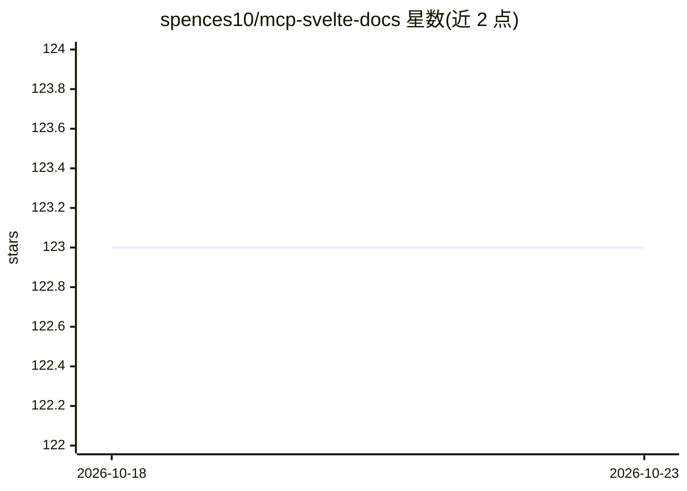

# spences10/mcp-svelte-docs

⭐ 123 · TypeScript · MIT · 推送 2026-10-13 · [GitHub](https://github.com/spences10/mcp-svelte-docs) · 个人维护

**为 AI 工具提供 Svelte 5/SvelteKit 文档查询的 MCP 服务器**

基于 Model Context Protocol 的服务器，向 Claude Desktop、Cursor、Windsurf 等客户端暴露单一 svelte_definition 工具。定义内容从官方 Svelte 5 TypeScript 声明中提取，覆盖 28+ 标识符：全部 runes、事件处理、迁移指南（Svelte 4→5）、TypeScript 接口与常见模式。支持 syntax/quick/full 三档响应格式，查询失败时提供模糊匹配建议与关联概念。README 给出多平台 MCP 客户端配置 JSON 示例（含 WSL 与非 WSL Windows），未展示具体安装命令。

## 筛选速览

| 维度 | 判定 | 备注 |
|---|---|---|
| AI 角色 | `ai-ecosystem` | LLM/agent 周边工具 |
| 许可风险 | `permissive` | MIT |
| 部署形态 | `None` |  |
| 模型依赖 | — | README 未给出锁定关系 |
| 硬件要求 | — | 无带数字的原话,不猜 |
| 安装摩擦 | `low` | 无编译、无系统依赖或容器化 |
| 成熟度 | — | 结构信号不足 |

## 能力要点

- 单一 svelte_definition 工具覆盖 28+ Svelte 5/SvelteKit 定义
- 定义提取自官方 TypeScript 声明
- syntax/quick/full 三档响应格式控制输出长度
- 拼写错误时模糊匹配建议正确标识符

## 适用场景

- 在 AI 编码助手中查询 Svelte 5 runes 的精确语法与参数
- 获取 Svelte 4 到 5 的迁移模式指导
- 让 Cursor/Claude Desktop 在写 SvelteKit 代码时引用最新 API 定义

## 场景标签

 · 领域:开发者工具/文档服务

## 证据(README 行号)

> L3: A Model Context Protocol (MCP) server providing authoritative Svelte 5
> L10: **Definition-First Approach**: Rather than multiple specialized tools,
> L106: Claude Desktop (via WSL)

## 星数曲线

2026-10-18 123 → 2026-10-23 123（+0）

---
*卡片 v1 · prompt 1.4 · 生成 2026-10-23 · 置信度 high · 依据 README sha `65588788c4f1` · [字段定义](../../DATASET.md)*
