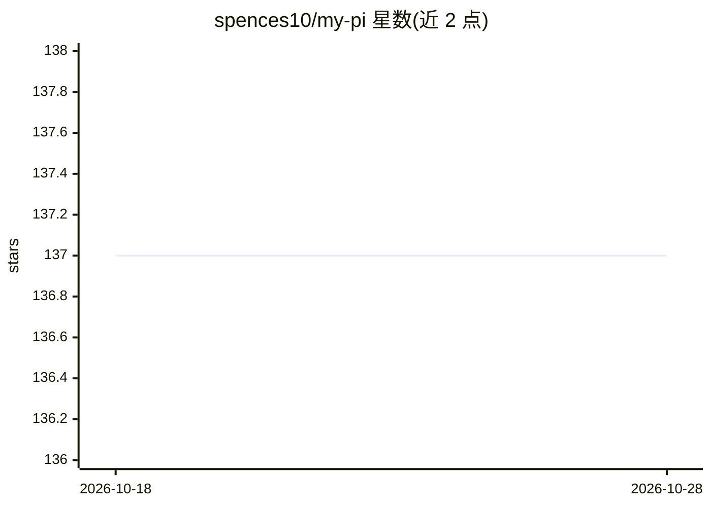

# spences10/my-pi

⭐ 138 · TypeScript · MIT · 推送 2026-10-28 · [GitHub](https://github.com/spences10/my-pi) · [官网](https://my-pi.dev) · 个人维护

**基于 Pi SDK 的编码 agent CLI 发行版，预置 MCP/LSP/技能/遥测**

构建在 @earendil-works/pi-coding-agent SDK 之上的策发型编码 agent CLI：以完整发行版或单独 @spences10/pi-* 包两种方式使用。预置项目感知的 MCP 工具与技能、LSP 诊断/符号工具、SQLite 上下文侧存与本地遥测/评测、输出脱敏、编码护栏、提示预设、Git UI 与多会话 team mode。要求 Node.js >=24.15.0，模型认证由 Pi 原生处理，内置 Umans.ai 与 OpenRouter Fusion 提供方。

## 筛选速览

| 维度 | 判定 | 备注 |
|---|---|---|
| AI 角色 | `ai-native` | 本体是模型或模型工具 |
| 许可风险 | `permissive` | MIT |
| 部署形态 | `library` | 以包/库形式分发 |
| 模型依赖 | locked-api |  |
| 硬件要求 | — | 无带数字的原话,不猜 |
| 安装摩擦 | `low` | 无编译、无系统依赖或容器化 |
| 成熟度 | — | 结构信号不足 |

## 能力要点

- 项目感知的 MCP 工具与技能，可按项目/组织限定加载范围
- LSP 诊断、悬停、定义、引用与文档符号工具
- 本地 SQLite 上下文侧存、遥测与 eval 数据收集
- 20+ 可独立安装的 Pi 扩展包（护栏、脱敏、team mode、观测面板等）

## 适用场景

- 作为即用的编码 agent CLI 直接使用完整发行版
- 在已有 Pi 环境中按需安装单个扩展功能
- 本地记录与分析编码 agent 会话遥测与评测数据

## 场景标签

`编码 Agent` · 领域:编码与开发

## 证据(README 行号)

> L7: My curated Pi distribution: a ready-to-run
> L8: coding-agent CLI with MCP, LSP, skills, recall, redaction, telemetry,
> L14: @earendil-works/pi-coding-agent

## 星数曲线

2026-10-18 137 → 2026-10-28 137（+0）

---
*卡片 v1 · prompt 1.4 · 生成 2026-10-23 · 置信度 high · 依据 README sha `73b212df3d1c` · [字段定义](../../DATASET.md)*
