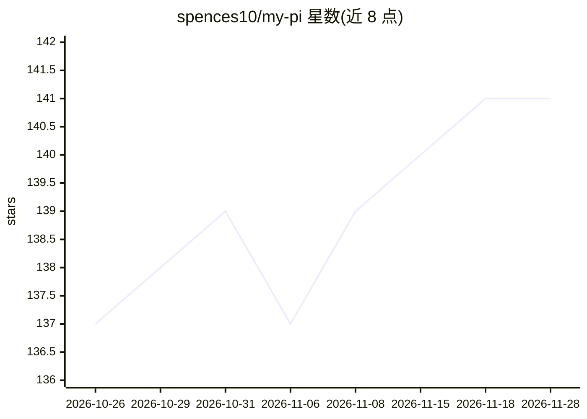

# spences10/my-pi

⭐ 141 · TypeScript · MIT · 推送 2026-11-27 · [GitHub](https://github.com/spences10/my-pi) · [官网](https://my-pi.dev) · 个人维护

**给 Pi 编码代理加扩展的开发者配置发行版**

面向 Pi 编码代理的扩展集合发行版：将上游 Pi 与作者自建扩展打包为 my-pi，扩展覆盖输出脱敏、LSP 诊断、超长工具输出的 SQLite FTS 缓存、后台提醒同步、本地 SQLite 遥测与事件流面板、团队模式的会话协调与持久邮箱、本地 RPC worker 等。每个扩展单独发布到 npm，可通过 /extensions 开关，也可用 pi install 单独安装到自有 Pi；MCP、codemode、skills、themes 等为上游功能。开发需 Node.js >=24.15 与 pnpm。

## 筛选速览

| 维度 | 判定 | 备注 |
|---|---|---|
| AI 角色 | `ai-ecosystem` | LLM/agent 周边工具 |
| 许可风险 | `permissive` | MIT |
| 部署形态 | `library` | 以包/库形式分发 |
| 模型依赖 | — | README 未给出锁定关系 |
| 硬件要求 | — | 无带数字的原话,不猜 |
| 安装摩擦 | `low` | 无编译、无系统依赖或容器化 |
| 成熟度 | — | 结构信号不足 |

## 能力要点

- 包含脱敏（pi-redact）、LSP 诊断、遥测、可观测性等约 20 个独立发布的扩展包
- 通过 /extensions 开关扩展，或 pi install 单独安装到自有 Pi
- 团队模式提供对等会话协调与持久邮箱，配合本地 RPC worker
- evals/ 提供冒烟评测套件（pnpm run eval:suite）

## 适用场景

- 为 Pi 编码代理添加脱敏、遥测与可观测性能力
- 用团队模式协调多个代理会话并通过邮箱持久通信
- 在编码代理中接入 LSP 诊断与符号工具
- 单独挑选某个 pi-* 包装入自己的 Pi 环境

## 场景标签

`编码 Agent` `LLM 可观测性` `模型评测` · 领域:编码与开发

## 证据(README 行号)

> L7: `my-pi` is my Pi: upstream Pi with my extensions
> L18: Turn extensions on or off with `/extensions`. Or install single
> L25: MCP, codemode, tool search, skills, themes, sessions, and package

## 星数曲线

2026-10-26 137 → 2026-11-28 141（+4）

---
*卡片 v1 · prompt 1.4 · 生成 2026-11-27 · 置信度 high · 依据 README sha `167874ba3c94` · [字段定义](../../DATASET.md)*
