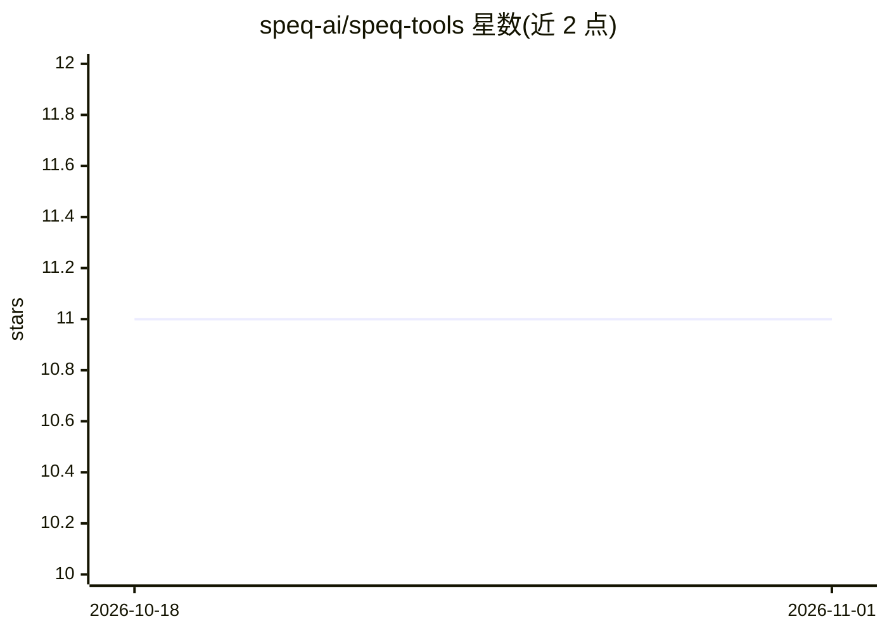

# speq-ai/speq-tools

⭐ 11 · TypeScript · MIT · 推送 2026-06-03 · [GitHub](https://github.com/speq-ai/speq-tools) · 组织维护

**面向开发者的 SPEQ 规格格式 CLI：创建、校验、更新与生成 AI 上下文**

SPEQ 规格格式（.speq 文件）的命令行伴侣工具：用 `speq new` 配合 AI 创建项目架构规格（实体、约束、分层边界、命名约定），`speq check` 校验并按严重度分组报告错误警告，`speq context` 从规格与构建状态生成可粘贴给任意 AI 助手的上下文块，`speq reverse`（开发中）可从既有代码库反向生成初始规格。BYOK 模式，通过 `speq setup` 自行配置 AI 供应商、API key 与模型，要求 Node.js 20+，无遥测，npm 全局安装。

## 筛选速览

| 维度 | 判定 | 备注 |
|---|---|---|
| AI 角色 | `ai-ecosystem` | LLM/agent 周边工具 |
| 许可风险 | `permissive` | MIT |
| 部署形态 | `library` | 以包/库形式分发 |
| 模型依赖 | — | README 未给出锁定关系 |
| 硬件要求 | — | 无带数字的原话,不猜 |
| 安装摩擦 | `low` | 无编译、无系统依赖或容器化 |
| 成熟度 | `idea` | |

## 能力要点

- 校验 .speq 规格并按严重度分组输出错误与警告
- 从规格与构建状态生成供任意 AI 助手使用的上下文块
- `speq reverse` 从既有代码库反向生成初始规格（开发中）
- BYOK：用户自配 AI 供应商、API key 与模型，无遥测

## 适用场景

- 为项目编写一次架构规格，让每次 AI 会话先读取再改代码
- 校验规格文件的错误并跟踪各实体的构建进度
- 把既有代码库反向工程为初始规格

## 场景标签

 · 领域:开发工具/规格驱动开发

## 证据(README 行号)

> L12: A `.speq` file is the architectural contract of your project. Entities, constraints, layer boundaries, naming conve
> L14: The CLI validates your spec, tracks build progress, and produces the context block you paste into any AI assistant.

## 星数曲线

2026-10-18 11 → 2026-11-01 11（+0）

---
*卡片 v1 · prompt 1.4 · 生成 2026-11-01 · 置信度 high · 依据 README sha `fa1640e0bc97` · [字段定义](../../DATASET.md)*
