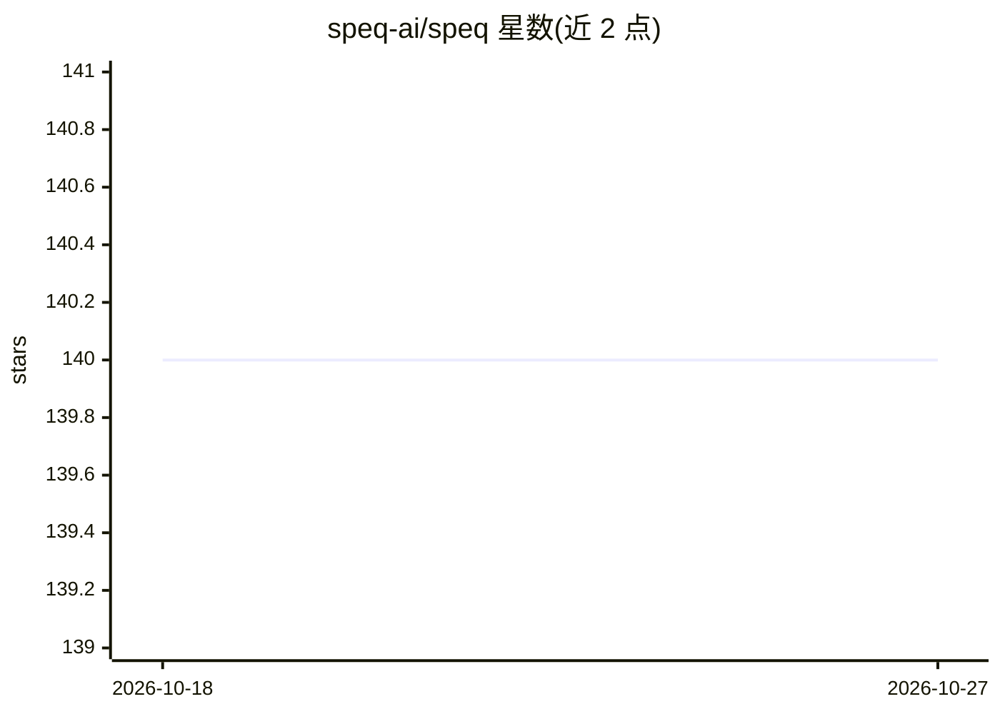

# speq-ai/speq

⭐ 140 · MIT · 推送 2026-03-11 · [GitHub](https://github.com/speq-ai/speq) · [官网](https://speq-ai.github.io/speq/) · 组织维护

**AI 辅助开发的声明式架构规范格式（.speq）**

SpeQ 定义一种 .speq 声明式规范格式，作为项目的架构契约：AI 编码会话在写代码前读取该规范，以在不同机器与模型间产出架构一致的输出。规范具备语法、解析器与校验器，区别于自然语言指令文件（如 AGENTS.md）。提供示例 .speq 文件与配套的 SpeQ SKILL（AI 行为契约），项目处于早期开发阶段，格式可用但语义精确性仍在完善。

## 筛选速览

| 维度 | 判定 | 备注 |
|---|---|---|
| AI 角色 | `ai-ecosystem` | LLM/agent 周边工具 |
| 许可风险 | `permissive` | MIT |
| 部署形态 | `None` |  |
| 模型依赖 | — | README 未给出锁定关系 |
| 硬件要求 | — | 无带数字的原话,不猜 |
| 安装摩擦 | `low` | 无编译、无系统依赖或容器化 |
| 成熟度 | `idea` | |

## 能力要点

- .speq 文件作为项目架构契约，AI 会话写码前读取
- 规范具备语法、解析器与校验器
- 提供多领域多复杂度的注释示例文件
- 配套 SpeQ SKILL 定义 AI 处理规范的行为契约

## 适用场景

- 让不同 AI 模型/会话在项目上产出架构一致的代码
- 大型代码库中以机器可校验格式固化架构决策
- 替代自然语言指令文件作为事实来源

## 场景标签

`提示工程` · 领域:Agent 开发

## 证据(README 行号)

> L7: A `.speq` file is the architectural contract of your project. You write it once. Every AI session reads it before wr
> L9: Natural language is inherently ambiguous. The same words mean different things across models, sessions, and prompts.

## 星数曲线

2026-10-18 140 → 2026-10-27 140（+0）

---
*卡片 v1 · prompt 1.4 · 生成 2026-10-22 · 置信度 high · 依据 README sha `e920a6b9a0c6` · [字段定义](../../DATASET.md)*
