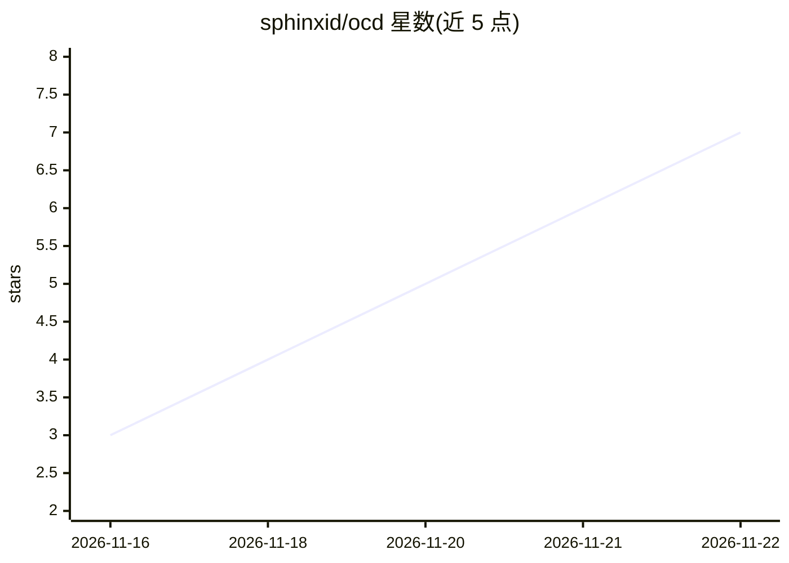

# sphinxid/ocd

⭐ 7 · Rust · MIT · 推送 2026-11-21 · [GitHub](https://github.com/sphinxid/ocd) · 个人维护

**opencode v2 终端 AI 编码代理的 Rust 重写替代实现**

将 opencode v2 终端 AI 编码代理用 Rust 重写，提供单文件自包含二进制，包含 TUI、服务器与 Web UI，兼容上游 CLI、HTTP API（173 个端点）、配置文件与数据目录，可直接读取既有会话、凭据与插件。通过安装脚本部署，支持自升级；README 给出与上游 2.2.7/2.3.1 的启动时间与内存对比数据，及 274/280 场景输出一致的对拍结果。提供沙箱以避免改动真实数据。

## 筛选速览

| 维度 | 判定 | 备注 |
|---|---|---|
| AI 角色 | `ai-native` | 本体是模型或模型工具 |
| 许可风险 | `permissive` | MIT |
| 部署形态 | `desktop` | 安装包/桌面程序 |
| 模型依赖 | — | README 未给出锁定关系 |
| 硬件要求 | — | 无带数字的原话,不猜 |
| 安装摩擦 | `medium` | 含编译或系统依赖之一 |
| 成熟度 | — | 结构信号不足 |

## 能力要点

- 单文件二进制集成 TUI、服务器与 Web UI
- 兼容上游 CLI、HTTP API、配置与数据目录
- 提供 `ocd upgrade` 自升级与沙箱模式
- 给出与上游的启动/内存对比及对拍场景结果

## 适用场景

- 在终端中使用 AI 编码代理且希望减少启动时间与内存占用
- 复用现有 opencode 的配置、会话与凭据而无需迁移
- 需要单二进制部署 TUI、服务器与 Web UI 的环境

## 场景标签

`编码 Agent` · 领域:编码与开发

## 证据(README 行号)

> L3: **ocd is opencode v2, the terminal AI coding agent, rewritten in Rust.**
> L4: It has the same CLI, TUI, HTTP API, config files and data folders, and it starts faster and uses far less memory.

## 星数曲线

2026-11-16 3 → 2026-11-22 7（+4）

---
*卡片 v1 · prompt 1.4 · 生成 2026-11-21 · 置信度 high · 依据 README sha `60ba3a46e1ab` · [字段定义](../../DATASET.md)*
