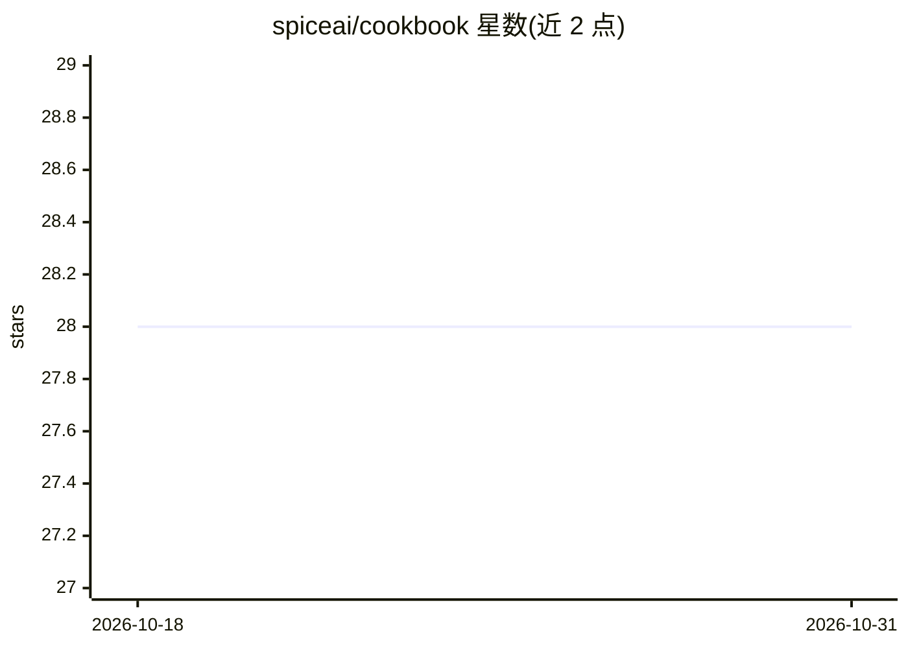

# spiceai/cookbook

⭐ 28 · Python · Apache-2.0 · 推送 2026-10-29 · [GitHub](https://github.com/spiceai/cookbook) · 组织维护

**Spice.ai 数据与 AI 应用的示例配方集合（教程库）**

Spice.ai 官方维护的 OSS Cookbook，收录大量自包含示例配方，覆盖联邦 SQL 查询、数据加速器（DuckDB/PostgreSQL/SQLite/Arrow 等）、30 余种数据连接器（S3、Snowflake、Databricks、Kafka 等）、目录连接器、向量引擎与混合搜索、在 SQL 中调用 LLM 的 ai() 函数、对接 OpenAI/Azure OpenAI/xAI/DeepSeek/NVIDIA NIM 等模型，以及 Kubernetes/Docker 部署、TPC-H 基准与各语言 SDK 用法。面向使用 Spice.ai 构建数据与 AI 应用的开发者，按类别组织可直接运行的示例工程。

## 筛选速览

| 维度 | 判定 | 备注 |
|---|---|---|
| AI 角色 | `ai-knowledge` | 知识聚合/清单类 |
| 许可风险 | `permissive` | Apache-2.0 |
| 部署形态 | `None` |  |
| 模型依赖 | — | README 未给出锁定关系 |
| 硬件要求 | — | 无带数字的原话,不猜 |
| 安装摩擦 | `low` | 无编译、无系统依赖或容器化 |
| 成熟度 | — | 结构信号不足 |

## 能力要点

- 覆盖联邦 SQL、数据加速器与 30 余种数据/目录连接器的示例配方
- 含 LLM 接入配方：ai() SQL 函数、OpenAI/Azure/xAI/DeepSeek、本地 Llama3、LLM 评测与 MCP
- Docker、Kubernetes、Sidecar/微服务部署配方与 TPC-H 基准测试示例
- Rust/Python/Go/JS/Java 客户端 SDK 查询示例

## 适用场景

- 查找 Spice.ai 连接特定数据源的示例代码
- 学习在 SQL 查询中调用 LLM 的用法
- 参考 Docker/Kubernetes 部署与数据加速配置方式

## 场景标签

`教程课程` · 领域:学习与行业

## 证据(README 行号)

> L1: # Spice.ai OSS Cookbook
> L3: Welcome to the Spice.ai OSS Cookbook—a comprehensive collection of recipes for building and deploying data & AI appl

## 星数曲线

2026-10-18 28 → 2026-10-31 28（+0）

---
*卡片 v1 · prompt 1.4 · 生成 2026-10-26 · 置信度 high · 依据 README sha `2606c3ed8710` · [字段定义](../../DATASET.md)*
