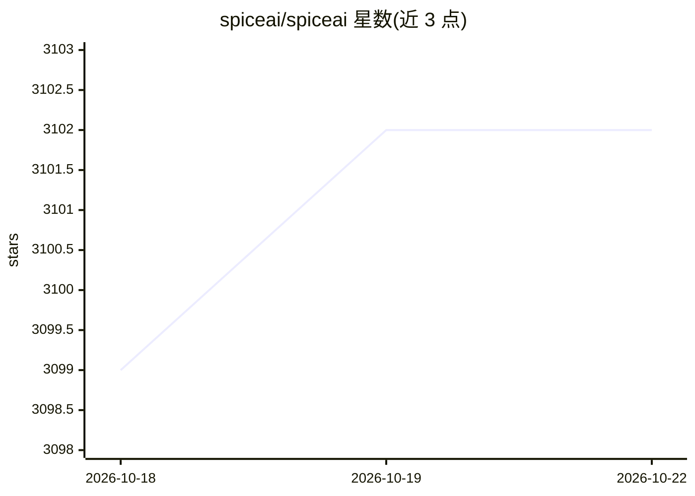

# spiceai/spiceai

⭐ 3,102 · Rust · Apache-2.0 · 推送 2026-10-21 · [GitHub](https://github.com/spiceai/spiceai) · [官网](https://docs.spiceai.org) · 组织维护

**给开发者的数据与 AI 引擎：联邦 SQL、搜索与 LLM 推理一体运行时**

Spice 是用 Rust 编写的单二进制数据与 AI 引擎，面向构建数据驱动 AI 应用和 agent 的开发者。通过 spicepod.yaml 声明 30+ 数据源（PostgreSQL、Snowflake、S3、Iceberg 等），可选内存/磁盘加速并经 CDC 保持新鲜；对外提供 SQL（HTTP/Arrow Flight/JDBC/ODBC/ADBC）、向量/全文/混合搜索、OpenAI 兼容 LLM 网关、NSQL text-to-SQL 以及 MCP server+gateway。Spice 2.0 起可为 PostgreSQL/MySQL/MongoDB 维护 CDC 分析副本，无需 Debezium/Kafka。支持单机 sidecar、独立服务或 Ballista 多节点集群部署。

## 筛选速览

| 维度 | 判定 | 备注 |
|---|---|---|
| AI 角色 | `ai-ecosystem` | LLM/agent 周边工具 |
| 许可风险 | `permissive` | Apache-2.0 |
| 部署形态 | `self-host` | docker 或自建部署 |
| 模型依赖 | local-ok | 支持本地模型 |
| 硬件要求 | — | 无带数字的原话,不猜 |
| 安装摩擦 | `low` | 无编译、无系统依赖或容器化 |
| 成熟度 | — | 结构信号不足 |

## 能力要点

- 30+ 数据连接器与查询下推的联邦 SQL 查询
- CDC 实时分析副本（PostgreSQL WAL/MySQL binlog/MongoDB change streams/DynamoDB Streams）
- OpenAI 兼容 API 网关（OpenAI/Anthropic/Bedrock/Vertex 等）与本地模型 serving
- MCP server + gateway 与 NSQL text-to-SQL

## 适用场景

- 为生产数据库加一个不拖垮业务的实时分析副本
- 让 AI agent 通过 SQL、搜索与 LLM 推理统一访问联邦数据
- 在应用旁部署 sidecar 数据平面获得毫秒级查询

## 场景标签

`数据分析` `模型网关` `语义搜索` · 领域:Agent 开发

## 证据(README 行号)

> L16: **Spice** (Spice.ai Open Source) is a data and AI engine that brings your data to your application. Connect it to t
> L24: Spice is a single binary written in Rust on Apache DataFusion, Apache Arrow, and Vortex. Run it next to your applic
> L40: - 🤖 **AI-native runtime** — OpenAI-compatible APIs, MCP server + gateway, LLM memory, NSQL text-to-SQL, multi-vecto

## 星数曲线

2026-10-18 3,099 → 2026-10-22 3,102（+3）

---
*卡片 v1 · prompt 1.4 · 生成 2026-10-21 · 置信度 mid · 依据 README sha `5d4de051cca5` · [字段定义](../../DATASET.md)*
