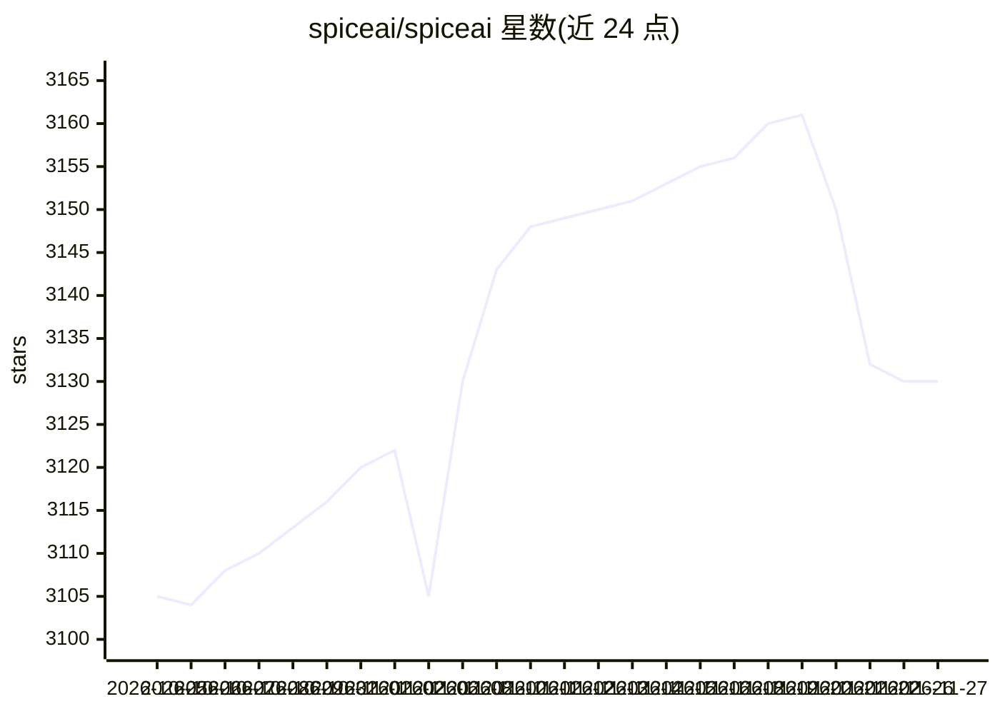

# spiceai/spiceai

⭐ 3,130 · Rust · Apache-2.0 · 推送 2026-11-26 · [GitHub](https://github.com/spiceai/spiceai) · [官网](https://docs.spiceai.org) · 组织维护

**为数据应用与 Agent 提供加速 SQL 查询、搜索与 LLM 推理的运行时**

Rust 编写的单二进制数据与 AI 引擎，基于 Apache DataFusion/Arrow/Ballista 构建。通过 spicepod.yaml 声明 30+ 数据源（PostgreSQL、S3、Iceberg 等），支持 CDC 实时复制到本地加速副本、内存/磁盘加速（Cayenne 引擎）、向量/全文/混合搜索，并通过 OpenAI 兼容 API 与 MCP 提供托管 LLM 网关和本地模型推理（CUDA/Metal 加速）。可以 sidecar、独立服务或多节点集群方式运行，提供 HTTP、Arrow Flight SQL、JDBC、ODBC、ADBC 接口。

## 筛选速览

| 维度 | 判定 | 备注 |
|---|---|---|
| AI 角色 | `ai-ecosystem` | LLM/agent 周边工具 |
| 许可风险 | `permissive` | Apache-2.0 |
| 部署形态 | `self-host` | docker 或自建部署 |
| 模型依赖 | locked-api |  |
| 硬件要求 | — | 无带数字的原话,不猜 |
| 安装摩擦 | `low` | 无编译、无系统依赖或容器化 |
| 成熟度 | — | 结构信号不足 |

## 能力要点

- 30+ 数据连接器与 CDC 实时复制（PostgreSQL WAL/MySQL binlog/MongoDB change streams）
- OpenAI 兼容 LLM 网关（OpenAI/Anthropic/xAI/Bedrock/Vertex AI/Databricks）与本地模型推理（CUDA/Metal）
- MCP server 与 gateway 双角色，Streamable HTTP 传输
- NSQL 自然语言转 SQL，与联邦 schema 对齐

## 适用场景

- 给运营数据库加一个实时分析副本，不影响生产负载
- 为 AI 应用和 Agent 提供低延迟 SQL 查询与混合搜索
- 通过统一网关接入多家 LLM 提供商并提供工具调用
- 以 sidecar 形式在应用旁提供本地数据平面

## 场景标签

`数据分析` `模型网关` `语义搜索` · 领域:Agent 开发

## 证据(README 行号)

> L16: **Spice** (Spice.ai Open Source) is a data and AI engine that brings your data to your application. Connect it to t
> L40: - 🤖 **AI-native runtime** — OpenAI-compatible APIs, MCP server + gateway, LLM memory, NSQL text-to-SQL, multi-vecto
> L55: 3. **OpenAI-Compatible APIs**: Hosted LLM gateway (OpenAI, Anthropic, xAI, Bedrock, Google Vertex AI, Databricks) a

## 星数曲线

2026-10-25 3,105 → 2026-11-27 3,130（+25）

---
*卡片 v1 · prompt 1.4 · 生成 2026-11-27 · 置信度 mid · 依据 README sha `9e1d0682cc2c` · [字段定义](../../DATASET.md)*
