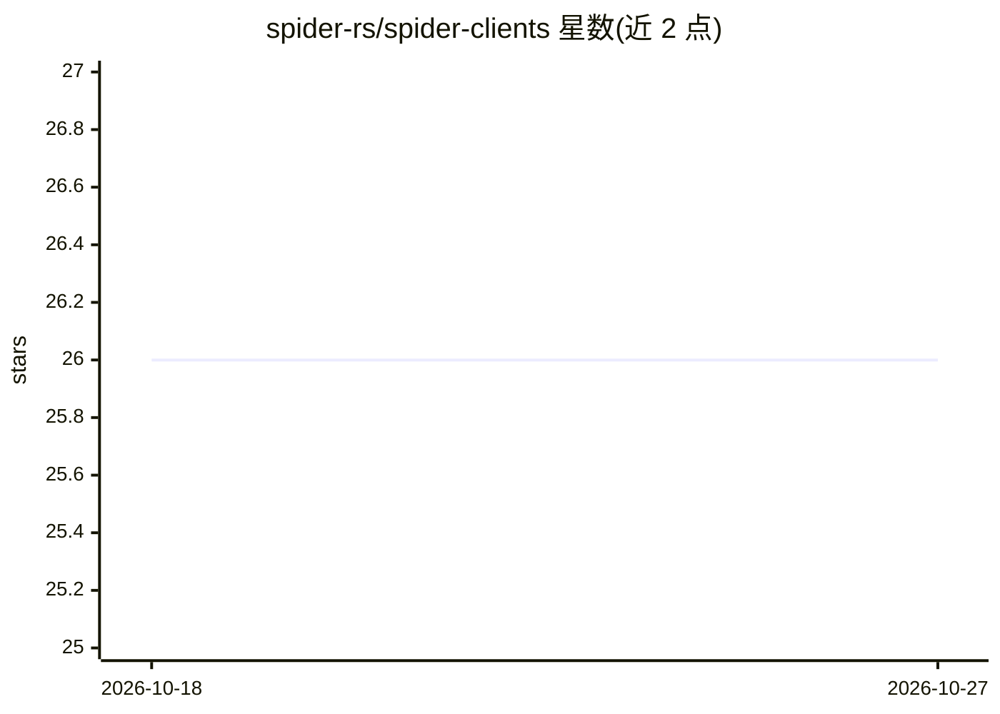

# spider-rs/spider-clients

⭐ 26 · Rust · MIT · 推送 2026-10-01 · [GitHub](https://github.com/spider-rs/spider-clients) · [官网](https://spider.cloud/github/clients) · 组织维护

**Spider Cloud 网页爬虫服务的多语言客户端库**

为 Spider Cloud 托管爬虫服务提供 Python、JavaScript、Rust、Go 与 CLI 客户端库，将各语言的爬取请求转发到 Spider 云端执行。仓库按语言分目录组织，各自包含安装说明与示例。README 列出的功能包括并发爬取、实时流式返回、无头 Chrome 渲染、HTTP 代理、定时任务、域名黑白名单与深度预算，以及 AI 驱动的 Smart Mode 与动态 AI 提示脚本化无头交互。爬取在云端或本地 Spider 引擎完成，客户端仅承担接入。

## 筛选速览

| 维度 | 判定 | 备注 |
|---|---|---|
| AI 角色 | `ai-enhanced` | 去掉 AI 部分产品仍成立 |
| 许可风险 | `permissive` | MIT |
| 部署形态 | `None` |  |
| 模型依赖 | — | README 未给出锁定关系 |
| 硬件要求 | — | 无带数字的原话,不猜 |
| 安装摩擦 | `low` | 无编译、无系统依赖或容器化 |
| 成熟度 | — | 结构信号不足 |

## 能力要点

- Python/JavaScript/Rust/Go/CLI 五种客户端库
- 流式返回爬取数据与无头 Chrome 渲染
- AI 驱动的 Smart Mode 与动态 AI 提示脚本化页面交互
- 支持定时任务、代理与黑白名单/深度预算控制

## 适用场景

- 在自己语言的工程里调用 Spider Cloud 完成网页爬取
- 为 AI agent 提供网页抓取与 HTML 转 Markdown 数据源
- 定时调度爬取任务并流式消费结果

## 场景标签

`网页抓取` · 领域:效率与自动化

## 证据(README 行号)

> L3: Discover the ultimate toolkit for integrating the fastest and most efficient web crawler **Spider** into your projec
> L32: - **Smart Mode:** Automate crawling tasks with AI-driven strategies for smarter data collection.

## 星数曲线

2026-10-18 26 → 2026-10-27 26（+0）

---
*卡片 v1 · prompt 1.4 · 生成 2026-10-26 · 置信度 mid · 依据 README sha `932d2aa90bdb` · [字段定义](../../DATASET.md)*
