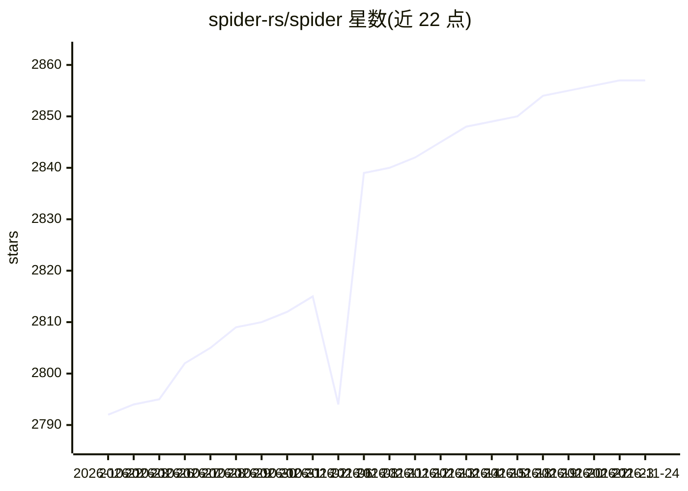

# spider-rs/spider

⭐ 2,857 · Rust · MIT · 推送 2026-11-20 · [GitHub](https://github.com/spider-rs/spider) · [官网](https://spider.cloud/github) · 组织维护

**为开发者提供低延迟网页抓取的 Rust 爬虫引擎**

并发优先的 Rust 爬虫引擎：页面到达即流式返回，仅在需要时启动无头 Chrome 渲染 JavaScript，内置代理、重试、限速与反屏蔽机制，同一套 API 可从单脚本扩展到分布式集群。同一引擎驱动 Spider Cloud 托管服务，本地运行无需 API key。分发形态包括 Rust 库、CLI、Node.js 与 Python 包、MCP server，README 列出 50+ 可运行示例。License 为 MIT。

## 筛选速览

| 维度 | 判定 | 备注 |
|---|---|---|
| AI 角色 | `ai-enhanced` | 去掉 AI 部分产品仍成立 |
| 许可风险 | `permissive` | MIT |
| 部署形态 | `library` | 以包/库形式分发 |
| 模型依赖 | — | README 未给出锁定关系 |
| 硬件要求 | — | 无带数字的原话,不猜 |
| 安装摩擦 | `low` | 无编译、无系统依赖或容器化 |
| 成熟度 | — | 结构信号不足 |

## 能力要点

- 页面流式返回，HTTP 优先、按需启动无头 Chrome
- 本地无 key 运行与 Spider Cloud 托管共用同一 API
- 提供 CLI、Node.js、Python 包及 MCP server 多种分发形态
- 内置代理、重试、限速与 stealth 能力

## 适用场景

- 把网页数据导入向量库供 LLM 与 RAG 管线使用
- 监控网站 SEO 与价格变化
- 将页面导出为 Markdown/JSON/WARC
- 驱动无头 Chrome 供 AI 浏览 agent 使用

## 场景标签

`网页抓取` · 领域:效率与自动化

## 证据(README 行号)

> L21: Spider is a concurrency-first crawling engine written in Rust. It streams pages as they arrive, renders JavaScript 
> L93: Teams use Spider to feed the open web into vector stores for LLM and RAG pipelines, monitor sites for SEO and price
> L73: |MCP server (Claude, Cursor, …)|`cargo install spider_mcp`|

## 星数曲线

2026-10-22 2,792 → 2026-11-24 2,857（+65）

---
*卡片 v1 · prompt 1.4 · 生成 2026-11-23 · 置信度 high · 依据 README sha `c7b66c1fe70d` · [字段定义](../../DATASET.md)*
