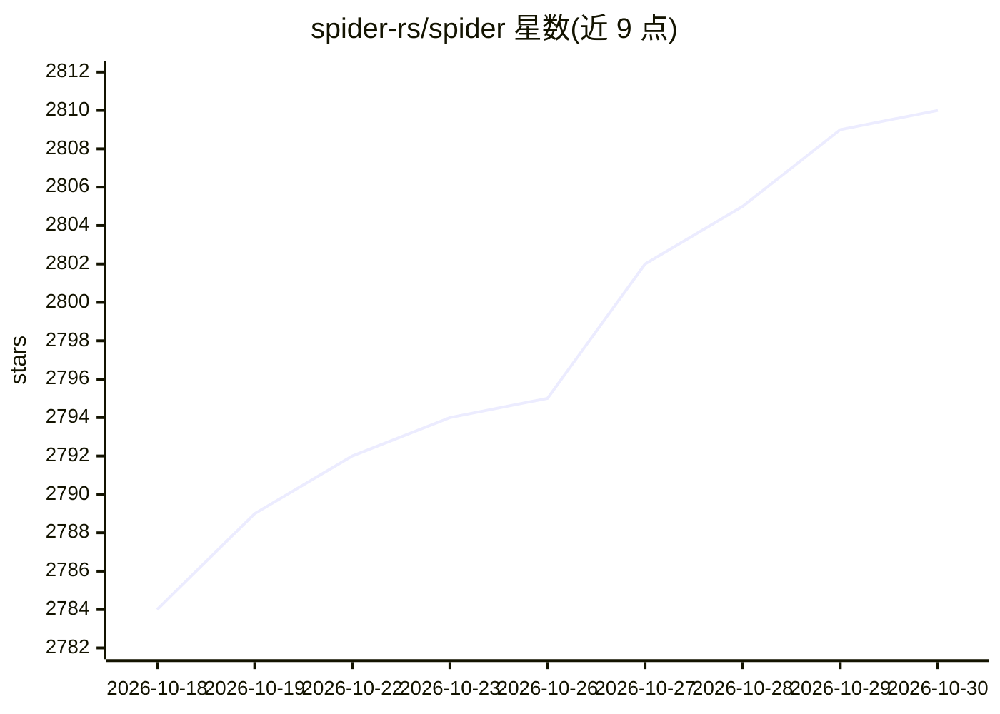

# spider-rs/spider

⭐ 2,810 · Rust · MIT · 推送 2026-10-23 · [GitHub](https://github.com/spider-rs/spider) · [官网](https://spider.cloud/github) · 组织维护

**Rust 编写的并发优先网页爬取与抓取引擎**

并发优先的 Rust 网页爬虫引擎：HTTP 优先请求，仅在页面需要时启动 headless Chrome 渲染，边抓取边流式返回页面；内置代理、重试、限速与隐身模式。同一 API 可从单脚本扩展到分布式工作集群，也可切换到同引擎托管的 Spider Cloud 服务。提供 Rust 库、CLI、Node.js 与 Python 包以及 MCP server 等多种安装形态。

## 筛选速览

| 维度 | 判定 | 备注 |
|---|---|---|
| AI 角色 | `ai-enhanced` | 去掉 AI 部分产品仍成立 |
| 许可风险 | `permissive` | MIT |
| 部署形态 | `library` | 以包/库形式分发 |
| 模型依赖 | — | README 未给出锁定关系 |
| 硬件要求 | — | 无带数字的原话,不猜 |
| 安装摩擦 | `low` | 无编译、无系统依赖或容器化 |
| 成熟度 | — | 结构信号不足 |

## 能力要点

- HTTP 优先、按需启动 headless Chrome 的流式抓取
- 同一 API 支持单机到分布式集群扩展
- 内置代理、重试、限速与隐身模式
- Rust/CLI/Node.js/Python/MCP server 多种交付形态

## 适用场景

- 为 LLM 与 RAG 管线把网页导入向量库
- 监控站点的 SEO 与价格变化
- 将页面导出为 Markdown、JSON 或 WARC
- 为 AI 浏览 agent 驱动 headless Chrome

## 场景标签

`网页抓取` · 领域:效率与自动化

## 证据(README 行号)

> L21: Spider is a concurrency-first crawling engine written in Rust. It streams pages as they arrive, renders JavaScript 
> L63: Spider runs HTTP-first and launches headless Chrome only when a page needs JavaScript. Both the HTTP and Chrome pat
> L93: Teams use Spider to feed the open web into vector stores for LLM and RAG pipelines, monitor sites for SEO and price

## 星数曲线

2026-10-18 2,784 → 2026-10-30 2,810（+26）

---
*卡片 v1 · prompt 1.4 · 生成 2026-10-21 · 置信度 mid · 依据 README sha `689d82c1d874` · [字段定义](../../DATASET.md)*
