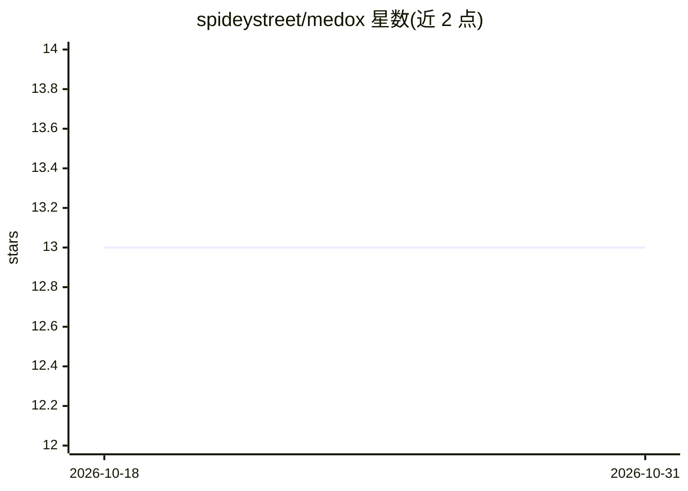

# spideystreet/medox

⭐ 13 · Python · Apache-2.0 · 推送 2026-09-30 · [GitHub](https://github.com/spideystreet/medox) · 个人维护

**面向法国药学人员的药物相互作用查询 AI agent**

面向法国医疗专业人员的药物交互查询工具：基于官方 BDPM 与 ANSM 数据库构建，用户询问某药物时在已索引的官方数据库中检索并带来源作答，涵盖 ANSM 交互等级（禁忌/慎用等）、按 CIS 码查询仿制药组、ANSM 安全警示及链接。每个药物均标注 CIS 码，工具未返回的信息模型不自行填补；ANSM 词库版本冻结于 2023-09-15，BDPM 文件每月刷新。技术栈为 Dagster→dbt(PostgreSQL+pgvector)→FastAPI(Mistral)→React，自标为实验性，不替代专业医疗建议。

## 筛选速览

| 维度 | 判定 | 备注 |
|---|---|---|
| AI 角色 | `ai-native` | 本体是模型或模型工具 |
| 许可风险 | `permissive` | Apache-2.0 |
| 部署形态 | `self-host` | docker 或自建部署 |
| 模型依赖 | — | README 未给出锁定关系 |
| 硬件要求 | — | 无带数字的原话,不猜 |
| 安装摩擦 | `low` | 无编译、无系统依赖或容器化 |
| 成熟度 | `idea` | |

## 能力要点

- 基于 BDPM/ANSM 官方数据索引检索并带来源作答
- ANSM 交互等级、BDPM 仿制药组、ANSM 安全警示查询
- 每条药物提及携带 CIS 码，模型不填补工具未返回的信息

## 适用场景

- 法国药师查询药物相互作用与禁忌等级
- 按 CIS 码查找仿制药分组
- 查阅 ANSM 药物安全警示通告

## 场景标签

`RAG` · 领域:知识与检索

## 证据(README 行号)

> L3: **Drug interaction checker for French healthcare professionals.**
> L16: You ask about a drug. Medox looks it up in the indexed official databases and answers with the source.

## 星数曲线

2026-10-18 13 → 2026-10-31 13（+0）

---
*卡片 v1 · prompt 1.4 · 生成 2026-10-31 · 置信度 high · 依据 README sha `bbc1c6e9681c` · [字段定义](../../DATASET.md)*
