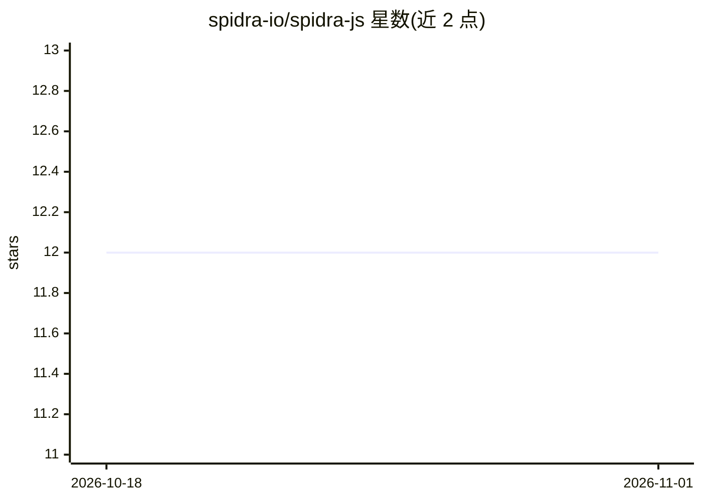

# spidra-io/spidra-js

⭐ 12 · TypeScript · MIT · 推送 2026-10-25 · [GitHub](https://github.com/spidra-io/spidra-js) · [官网](https://spidra.io/) · 组织维护

**Spidra 网页抓取/搜索服务的官方 Node.js SDK**

面向 Node.js/TypeScript 开发者的官方 SDK，封装 Spidra API：网页搜索（web/news/images/videos/research/developer 六种来源）、单页抓取（最多 3 URL 并行）、浏览器动作序列（click/type/scroll/evaluate 等 13 种）、批量处理与整站爬取。抓取结果返回 markdown 或按 JSON Schema/Zod schema 约束的结构化 JSON，支持 geo 代理路由、cookie 认证页面与全页截图。需在 app.spidra.io 获取 API key 使用。

## 筛选速览

| 维度 | 判定 | 备注 |
|---|---|---|
| AI 角色 | `ai-ecosystem` | LLM/agent 周边工具 |
| 许可风险 | `permissive` | MIT |
| 部署形态 | `library` | 以包/库形式分发 |
| 模型依赖 | — | README 未给出锁定关系 |
| 硬件要求 | — | 无带数字的原话,不猜 |
| 安装摩擦 | `low` | 无编译、无系统依赖或容器化 |
| 成熟度 | — | 结构信号不足 |

## 能力要点

- 六种来源搜索（含 arXiv/PubMed 论文与 GitHub issues）
- prompt + JSON Schema/Zod schema 的 AI 结构化抽取，缺失字段返回 null
- 13 种浏览器动作（click/type/scrollUntilEnd/evaluate/forEach 等）
- geo 代理路由（40+ 国家）、cookie 认证页面抓取

## 适用场景

- 为 LLM 管线准备干净的 markdown 语料
- 按 schema 抽取网页数据为结构化 JSON
- 对登录后或地区限制页面做抓取
- 在抓取前自动执行点击、滚动等浏览器操作

## 场景标签

`网页抓取` · 领域:效率与自动化

## 证据(README 行号)

> L3: This is the official Node.js SDK for Spidra. It searches the web, scrapes pages, runs browser actions, batch-process
> L5: Every result comes back as structured data, clean markdown ready to feed into an LLM pipeline, your own systems and 

## 星数曲线

2026-10-18 12 → 2026-11-01 12（+0）

---
*卡片 v1 · prompt 1.4 · 生成 2026-11-01 · 置信度 high · 依据 README sha `3558f4c14fcf` · [字段定义](../../DATASET.md)*
