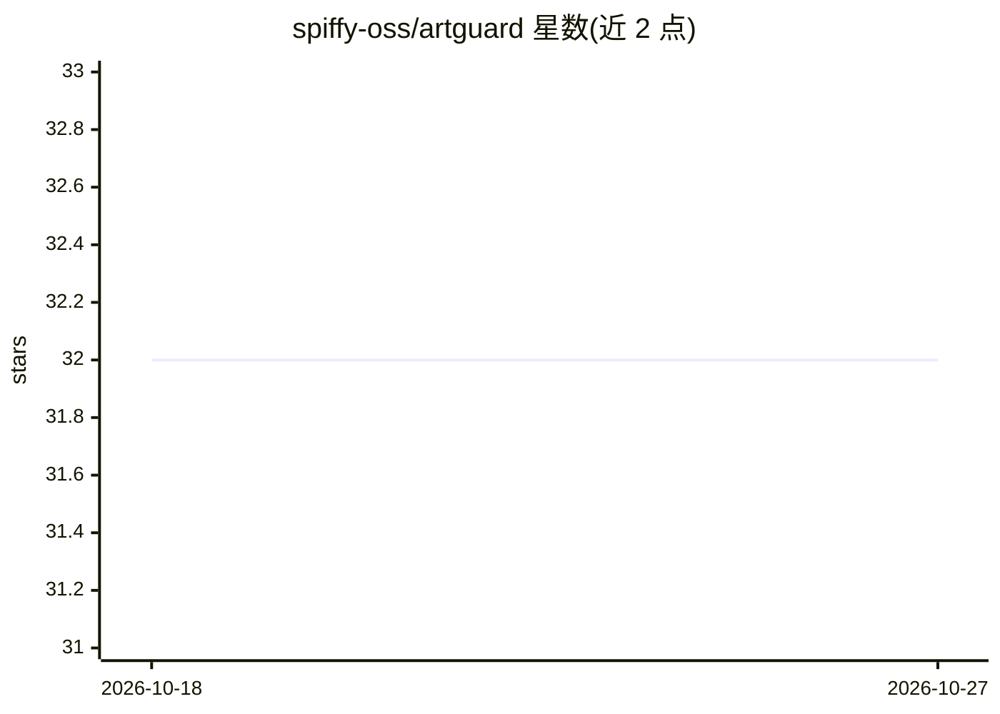

# spiffy-oss/artguard

⭐ 32 · MIT · 推送 2026-03-05 · [GitHub](https://github.com/spiffy-oss/artguard) · 组织维护

**扫描 agent 技能、MCP 配置与 IDE 规则文件的安全检测 CLI**

以 Claude Code 提示词形式交付的项目：将提示词粘贴进 Claude Code 后自动生成 artguard CLI（Python 3.11+），扫描 agent 技能文件、MCP server 配置、IDE 规则文件与插件清单。检测分三层：隐私姿态分析（声明行为与实际行为的差异）、LLM 驱动的语义指令分析（提示注入/上下文污染等，需 Anthropic API key）、以及基于 YARA 与启发式引擎的静态模式匹配。每次扫描输出结构化 Trust Profile JSON，供策略引擎与审计使用。面向需要对企业内 AI 工件做安全审查的场景。

## 筛选速览

| 维度 | 判定 | 备注 |
|---|---|---|
| AI 角色 | `ai-ecosystem` | LLM/agent 周边工具 |
| 许可风险 | `permissive` | MIT |
| 部署形态 | `None` |  |
| 模型依赖 | locked-api |  |
| 硬件要求 | — | 无带数字的原话,不猜 |
| 安装摩擦 | `low` | 无编译、无系统依赖或容器化 |
| 成熟度 | — | 结构信号不足 |

## 能力要点

- 三层检测：隐私姿态分析、LLM 语义指令分析、YARA 静态模式匹配
- 扫描 skills.md、mcp.json、.cursorrules 等 AI 工件
- 输出 Trust Profile JSON（AI BOM），供策略引擎与审计消费
- Layer 2 需 Anthropic API key，Layer 3 集成开源扫描源

## 适用场景

- 企业在安装 MCP server 或 agent 技能前做安全审查
- 检测 IDE 规则文件中的提示注入与行为操纵指令
- 生成 AI 工件清单供合规审计与访问控制使用

## 场景标签

`网络安全` · 领域:学习与行业

## 证据(README 行号)

> L10: that scans agent skills, MCP server configs, and IDE rule files for security threats,
> L44: LLM-powered detection of behavioral manipulation, prompt injection, context

## 星数曲线

2026-10-18 32 → 2026-10-27 32（+0）

---
*卡片 v1 · prompt 1.4 · 生成 2026-10-25 · 置信度 high · 依据 README sha `859020bf924b` · [字段定义](../../DATASET.md)*
