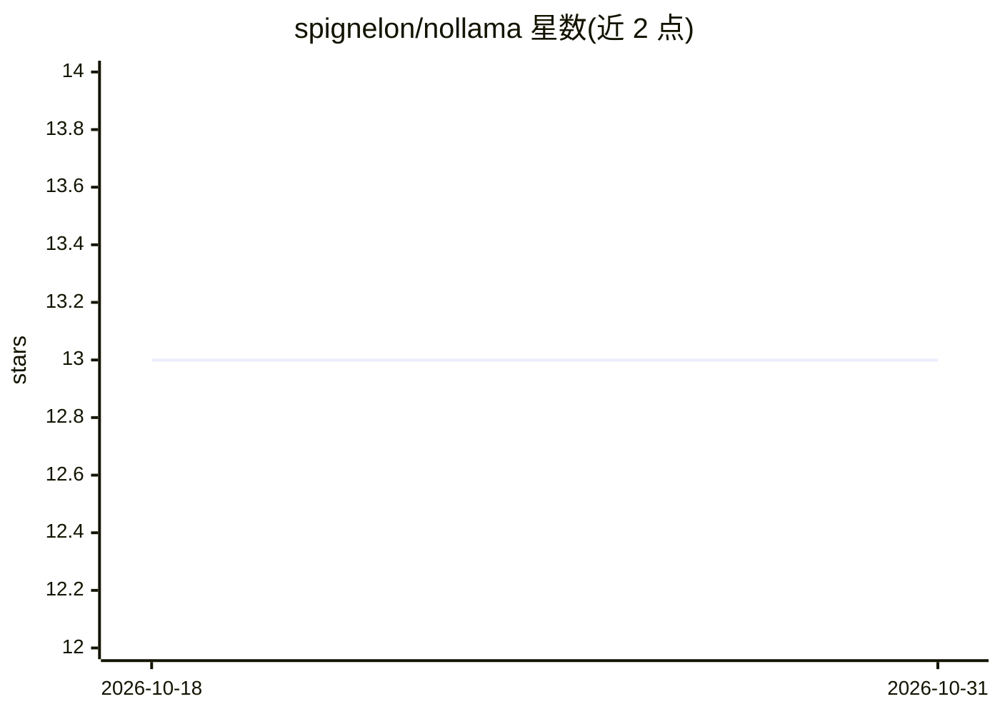

# spignelon/nollama

⭐ 13 · Python · GPL-3.0 · 推送 2026-05-19 · [GitHub](https://github.com/spignelon/nollama) · [官网](https://pypi.org/project/nollama/) · 个人维护

**终端多 LLM 聊天界面：统一接入 8 家模型供应商**

基于 LiteLLM 的终端 LLM 聊天客户端，统一接入 Google Gemini、Vertex AI、Anthropic Claude、OpenAI、Groq、DeepSeek、OpenRouter 及本地 Ollama 共 8 家供应商。支持动态模型发现（无硬编码列表）、vim 风格模型搜索、多轮对话、流式输出与 Markdown 渲染，聊天中可随时切换供应商/模型。API key 通过 .env 或 ~/.nollama 文件配置，PyPI 提供安装，声明与 Ollama 无隶属关系。GPL-3.0 许可。

## 筛选速览

| 维度 | 判定 | 备注 |
|---|---|---|
| AI 角色 | `ai-ecosystem` | LLM/agent 周边工具 |
| 许可风险 | `viral` | GPL-3.0 |
| 部署形态 | `library` | 以包/库形式分发 |
| 模型依赖 | local-ok | 支持本地模型 |
| 硬件要求 | — | 无带数字的原话,不猜 |
| 安装摩擦 | `low` | 无编译、无系统依赖或容器化 |
| 成熟度 | — | 结构信号不足 |

## 能力要点

- 经 LiteLLM 统一接入 8 家 LLM 供应商
- 动态模型发现与 vim 风格模型搜索
- 多轮对话、流式输出与 Markdown 渲染
- 聊天中随时切换供应商/模型

## 适用场景

- 在终端里同时使用多家 LLM 供应商的模型聊天
- 在数百个模型中快速搜索并切换
- 用本地 Ollama 实例进行终端对话

## 场景标签

`聊天机器人` · 领域:对话与助手

## 证据(README 行号)

> L3: NoLlama is a powerful terminal-based interface for interacting with **multiple LLM providers** directly from your te
> L5: Inspired by Ollama, NoLlama offers a neat terminal interface for powerful language models with features like **dynam

## 星数曲线

2026-10-18 13 → 2026-10-31 13（+0）

---
*卡片 v1 · prompt 1.4 · 生成 2026-10-31 · 置信度 high · 依据 README sha `a2d3229ecb61` · [字段定义](../../DATASET.md)*
