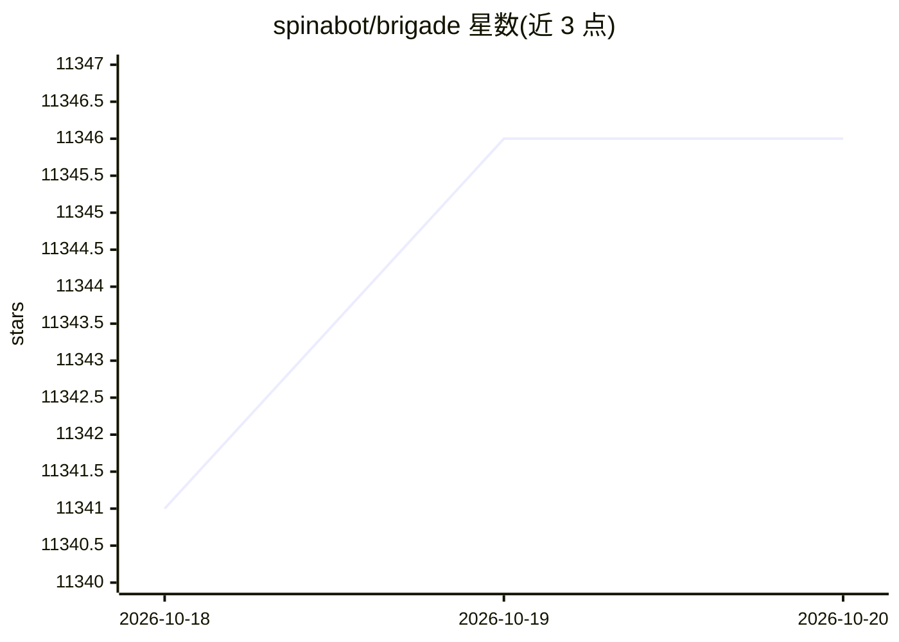

# spinabot/brigade

⭐ 11,346 · TypeScript · MIT · 推送 2026-10-16 · [GitHub](https://github.com/spinabot/brigade) · [官网](https://www.brigade.spinabot.com) · 组织维护

**自托管的个人 AI agent 团队运行时：多 agent 共享长期记忆**

Brigade 是一个自托管的 AI agent 生态系统：用户通过终端 TUI、WhatsApp/Telegram/Slack/Discord/iMessage 等渠道与一支按组织架构协作的 agent 团队对话。核心机制包括共享长期记忆引擎 Tideline（文件存储、BM25+向量混合召回、来源隔离）、子 agent 派生、技能系统（内置 56 个技能）、cron 调度、经 Composio 提供 1000+ 应用连接器，以及 MCP 支持。模型可接入 Anthropic/OpenAI/Gemini/本地 Ollama 等，密钥与数据留在本机，默认文件系统存储，可选自托管 Convex 后端。单一 Node 二进制，安装脚本或 npm 全局安装，可运行于树莓派或服务器。

## 筛选速览

| 维度 | 判定 | 备注 |
|---|---|---|
| AI 角色 | `ai-native` | 本体是模型或模型工具 |
| 许可风险 | `permissive` | MIT |
| 部署形态 | `library` | 以包/库形式分发 |
| 模型依赖 | local-ok | 支持本地模型 |
| 硬件要求 | — | 无带数字的原话,不猜 |
| 安装摩擦 | `medium` | 含编译或系统依赖之一 |
| 成熟度 | — | 结构信号不足 |

## 能力要点

- 多 agent 按组织架构（org chart）协作，共享 Tideline 长期记忆（BM25+向量混合召回、来源隔离与衰减）
- 终端 TUI 与 WhatsApp/Telegram/Slack/Discord/iMessage/BlueBubbles 多渠道接入同一网关
- 经 Composio 提供 1,000+ 应用连接器（Gmail/Slack/GitHub/Notion 等）与 MCP 内存服务器
- 支持 Anthropic/OpenAI/Gemini/OpenRouter/本地 Ollama 等模型，可对话中途切换

## 适用场景

- 在自己机器上运行一支可从聊天软件随时召唤的私人 AI agent 团队
- 让多个 agent 分工协作处理文档读写、定时任务和应用操作
- 不依赖 SaaS、密钥与数据全部留在本机地使用多个模型

## 场景标签

`多智能体` `Agent 记忆` · 领域:Agent 开发

## 证据(README 行号)

> L34: **Brigade is your personal intelligence, built on enterprise-grade tech**: a crew of
> L35: AI agents on a real org chart that share one long-term memory, Tideline, so what one
> L55: Start it and you get a fast chat TUI. Keep going and you get isolated agents with

## 星数曲线

2026-10-18 11,341 → 2026-10-20 11,346（+5）

---
*卡片 v1 · prompt 1.4 · 生成 2026-10-20 · 置信度 high · 依据 README sha `1d6d598d0d1b` · [字段定义](../../DATASET.md)*
