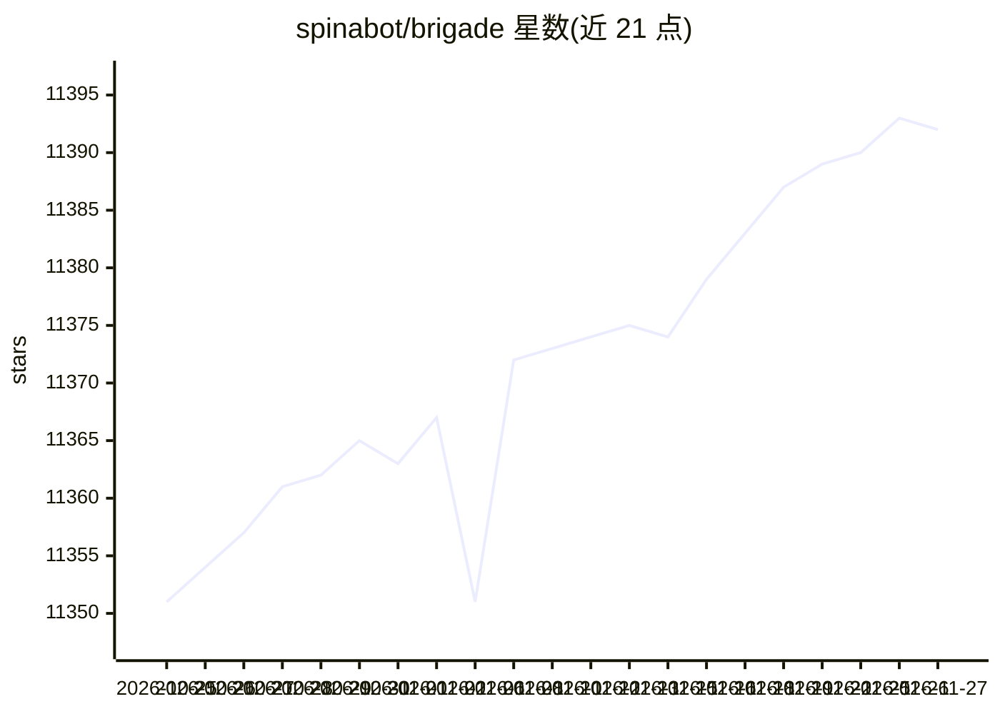

# spinabot/brigade

⭐ 11,392 · TypeScript · MIT · 推送 2026-11-13 · [GitHub](https://github.com/spinabot/brigade) · [官网](https://www.brigade.spinabot.com) · 个人维护

**自托管的多人格 AI Agent 网关运行时，多渠道接入**

单二进制架构：常驻 gateway 进程持有全部状态并运行 Agent，TUI、WhatsApp/Telegram/Slack/Discord/iMessage 等渠道适配器均为其 WebSocket 薄客户端。多个 Agent 以组织图方式协作，共享 Tideline 长期记忆（BM25+向量混合召回、来源作用域、衰减），支持子 Agent 派生、cron 调度、56 个内置技能、MCP 内存服务与 1,000+ Composio 应用连接器。数据全部存于 ~/.brigade/，密钥本地 0600 存储，无遥测。

## 筛选速览

| 维度 | 判定 | 备注 |
|---|---|---|
| AI 角色 | `ai-ecosystem` | LLM/agent 周边工具 |
| 许可风险 | `permissive` | MIT |
| 部署形态 | `library` | 以包/库形式分发 |
| 模型依赖 | local-ok | 支持本地模型 |
| 硬件要求 | — | 无带数字的原话,不猜 |
| 安装摩擦 | `medium` | 含编译或系统依赖之一 |
| 成熟度 | — | 结构信号不足 |

## 能力要点

- gateway/薄客户端架构：断开重连后 Agent 持续运行
- Tideline 记忆引擎：混合召回、来源隔离与写入门控
- 接入 WhatsApp、Telegram、Slack、Discord、iMessage 等渠道
- 支持多提供商切换与本地 Ollama，密钥不出本机

## 适用场景

- 自托管一套多 Agent 助手，通过聊天软件随时调用
- 让多个有独立凭证的 Agent 协作处理任务并共享记忆
- 用 cron 让 Agent 定时执行任务，配置系统服务常驻

## 场景标签

`Agent 记忆` `多智能体` `AI 助手` · 领域:Agent 开发

## 证据(README 行号)

> L146: Brigade is one binary that can act as a **gateway** (the long-lived process that
> L34: **Brigade is your personal intelligence, built on enterprise-grade tech**: a crew of
> L55: Start it and you get a fast chat TUI. Keep going and you get isolated agents with

## 星数曲线

2026-10-25 11,351 → 2026-11-27 11,392（+41）

---
*卡片 v1 · prompt 1.4 · 生成 2026-11-22 · 置信度 high · 依据 README sha `3e4508b01ec3` · [字段定义](../../DATASET.md)*
