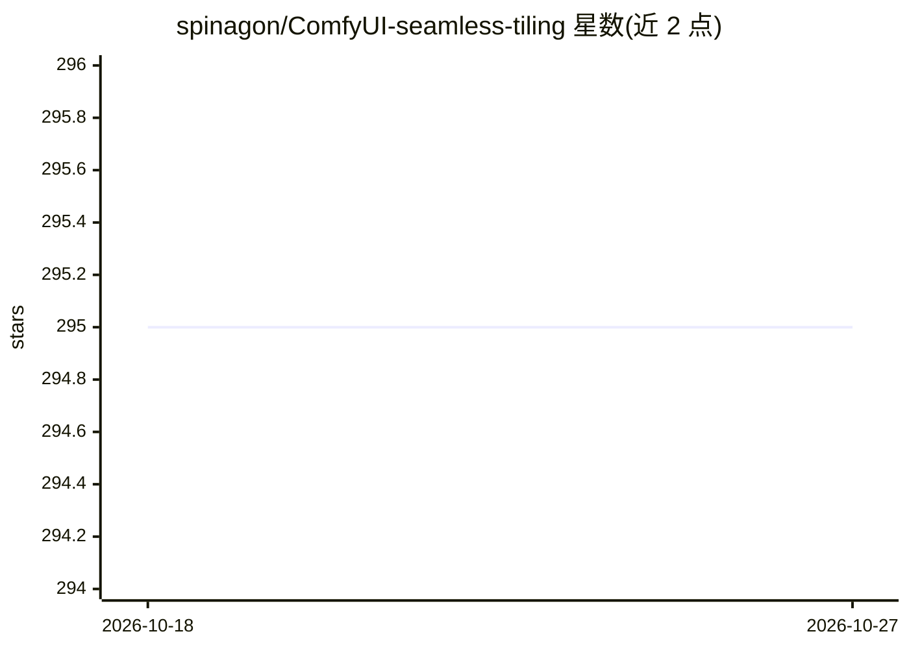

# spinagon/ComfyUI-seamless-tiling

⭐ 295 · Python · GPL-3.0 · 推送 2026-02-12 · [GitHub](https://github.com/spinagon/ComfyUI-seamless-tiling) · 个人维护

**ComfyUI 无缝贴图节点：生成可平铺纹理**

为 ComfyUI 提供自定义节点的扩展插件，用于生成无缝纹理，复刻 A1111 的 Tiling 选项并支持 X/Y 轴独立平铺。包含 Seamless Tile 节点（放在加载器与采样器之间修改模型）、Make Circular VAE 与 Circular VAE Decode 节点（循环卷积解码，前者只修改一次 VAE 更高效）、以及用于检查接缝的 Offset Image 节点。部分实现源自 tiled_ksampler 与 asymmetric-tiling-sd-webui 项目。README 未给出安装命令。

## 筛选速览

| 维度 | 判定 | 备注 |
|---|---|---|
| AI 角色 | `ai-ecosystem` | LLM/agent 周边工具 |
| 许可风险 | `viral` | GPL-3.0 |
| 部署形态 | `None` |  |
| 模型依赖 | — | README 未给出锁定关系 |
| 硬件要求 | — | 无带数字的原话,不猜 |
| 安装摩擦 | `low` | 无编译、无系统依赖或容器化 |
| 成熟度 | — | 结构信号不足 |

## 能力要点

- 复刻 A1111 Tiling 选项，支持 X/Y 独立平铺
- 提供 Seamless Tile / Make Circular VAE / Circular VAE Decode / Offset Image 四类节点
- Make Circular VAE 仅修改一次 VAE 模型以提升效率

## 适用场景

- 在 ComfyUI 中生成游戏或材质用的无缝贴图
- 检查生成纹理的接缝问题

## 场景标签

`图像生成` · 领域:内容生成

## 证据(README 行号)

> L6: ComfyUI nodes for generating seamless textures. Replicates "Tiling" option from A1111, including independent X/Y til
> L8: Use "Seamless Tile" node between loader and samplers to modify model, and "Make Circular VAE" or "Circular VAE Decod

## 星数曲线

2026-10-18 295 → 2026-10-27 295（+0）

---
*卡片 v1 · prompt 1.4 · 生成 2026-10-21 · 置信度 high · 依据 README sha `2bacacb99a01` · [字段定义](../../DATASET.md)*
