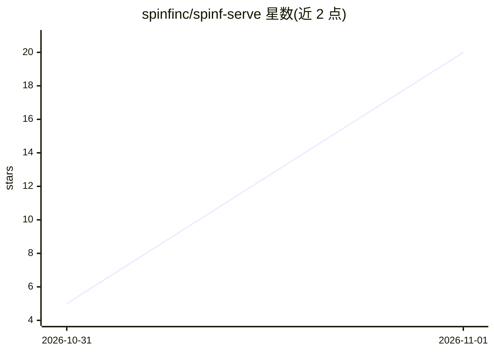

# spinfinc/spinf-serve

⭐ 20 · Python · Apache-2.0 · 推送 2026-10-29 · [GitHub](https://github.com/spinfinc/spinf-serve) · [官网](https://spinf.com) · 组织维护

**单 GPU 批量分类与决策推理服务：内容读一次，多问题同批打分**

面向吞吐的自托管推理引擎：一段内容只读一次，把多个问题作为同一次前向传播的分支打分，每个答案返回各选项概率而非生成文本；支持图像/音频/视频帧输入、文本抽取槽位、prompt pack（内容审核等预校准问题集）。提供 OpenAI 兼容 API，客户端可切换到托管服务 api.spinf.com。需 24GB NVIDIA GPU（fp8 张量核心，Ampere 可用 int8 权重）与 CUDA 13 驱动，通过 pip 或 Docker 镜像运行；当前为版本 0.1，缺项列于文档。

## 筛选速览

| 维度 | 判定 | 备注 |
|---|---|---|
| AI 角色 | `ai-ecosystem` | LLM/agent 周边工具 |
| 许可风险 | `permissive` | Apache-2.0 |
| 部署形态 | `self-host` | docker 或自建部署 |
| 模型依赖 | — | README 未给出锁定关系 |
| 硬件要求 | — | 无带数字的原话,不猜 |
| 安装摩擦 | `low` | 无编译、无系统依赖或容器化 |
| 成熟度 | `idea` | |

## 能力要点

- 一次读取内容、多个问题作为同一前向传播分支打分，每选项输出概率
- fp8 checkpoint 下分数逐位一致（batch invariance），含 system_fingerprint 标记可比性
- prompt pack：预校准问题集（如 spinf/moderation 106 问 22 类）按名调用
- 提供 4 个量化校准 checkpoint（Gemma 4 / Qwen / pplx-decider），任何受支持架构的 Hub checkpoint 可加载

## 适用场景

- 海量新闻/消息的内容审核与批量分类打分
- 对同一内容一次提出几十个校准问题并阈值化决策
- 在自有 GPU 上自托管替代托管打分 API

## 场景标签

`推理引擎` · 领域:训练与推理

## 证据(README 行号)

> L6: probability over the options you give, not generated text. It runs on one 24 GB NVIDIA GPU and serves an
> L22: It is not a chat server. Nothing is generated unless you ask for it, and it is built for throughput rather than for
> L40: docker run --gpus all -p 8000:8000 -v spinf-cache:/root/.cache ghcr.io/spinfinc/spinf-serve

## 星数曲线

2026-10-31 5 → 2026-11-01 20（+15）

---
*卡片 v1 · prompt 1.4 · 生成 2026-10-31 · 置信度 high · 依据 README sha `14ef16b1b904` · [字段定义](../../DATASET.md)*
