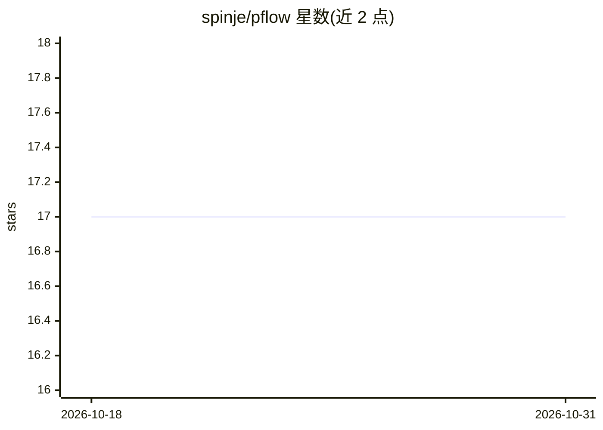

# spinje/pflow

⭐ 17 · Python · NOASSERTION · 推送 2026-10-26 · [GitHub](https://github.com/spinje/pflow) · [官网](https://docs.pflow.run) · 个人维护

**供 AI agent 构建与复用自动化工作流的 CLI 工具**

面向 AI agent 的 CLI 工具：将 LLM 调用、shell 命令、Python 代码、HTTP 请求、文件操作、MCP 工具及 agent 委托共 8 种节点类型组合为 .pflow.md 工作流文件，保存后即可作为可复用 CLI 命令执行，步骤间通过模板变量传递数据。运行前做静态校验并向 agent 输出可操作的错误提示与修复建议。工作流可发布为 Skills 供 Claude Code、Cursor 等平台使用；支持 MCP server 模式。需 Python 3.10+，Windows 上 shell 步骤经 Git Bash 运行。作者自述自 2025 年中开发，定位为捕获已探索任务的确定路径，不适用于需动态适应的场景。

## 筛选速览

| 维度 | 判定 | 备注 |
|---|---|---|
| AI 角色 | `ai-ecosystem` | LLM/agent 周边工具 |
| 许可风险 | `none` | NOASSERTION |
| 部署形态 | `None` |  |
| 模型依赖 | — | README 未给出锁定关系 |
| 硬件要求 | — | 无带数字的原话,不猜 |
| 安装摩擦 | `low` | 无编译、无系统依赖或容器化 |
| 成熟度 | — | 结构信号不足 |

## 能力要点

- 8 种节点类型（shell/code/http/llm/mcp/agent 等）组合为 .pflow.md 工作流
- 保存的工作流可发布为 Skills，跨 Claude Code、Cursor 等平台使用
- 运行前静态校验（模板引用、输入缺失、类型不匹配）并给出修复建议
- 工作流可嵌套调用，支持 JSON 输出与 MCP server 模式

## 适用场景

- 让 agent 把一次摸索出的多步任务固化为可重复执行的命令
- 自动生成 CHANGELOG、发布公告等发布流程
- 在 Claude Code / Cursor 等环境中通过 bash 直接调用工作流

## 场景标签

`工作流自动化` · 领域:效率与自动化

## 证据(README 行号)

> L10: pflow helps your agent build workflows it can reuse. It composes pre-built nodes — LLM calls, shell commands, HTTP 
> L71: pflow has 8 node types: `shell`, `code` (Python), `http`, file operations, `llm` calls, `mcp` tools, and an `agent`
> L106: pflow is CLI-first because agents in Claude Code, Cursor, and similar tools always have bash. No MCP configuration

## 星数曲线

2026-10-18 17 → 2026-10-31 17（+0）

---
*卡片 v1 · prompt 1.4 · 生成 2026-10-29 · 置信度 high · 依据 README sha `4a1e89867d62` · [字段定义](../../DATASET.md)*
