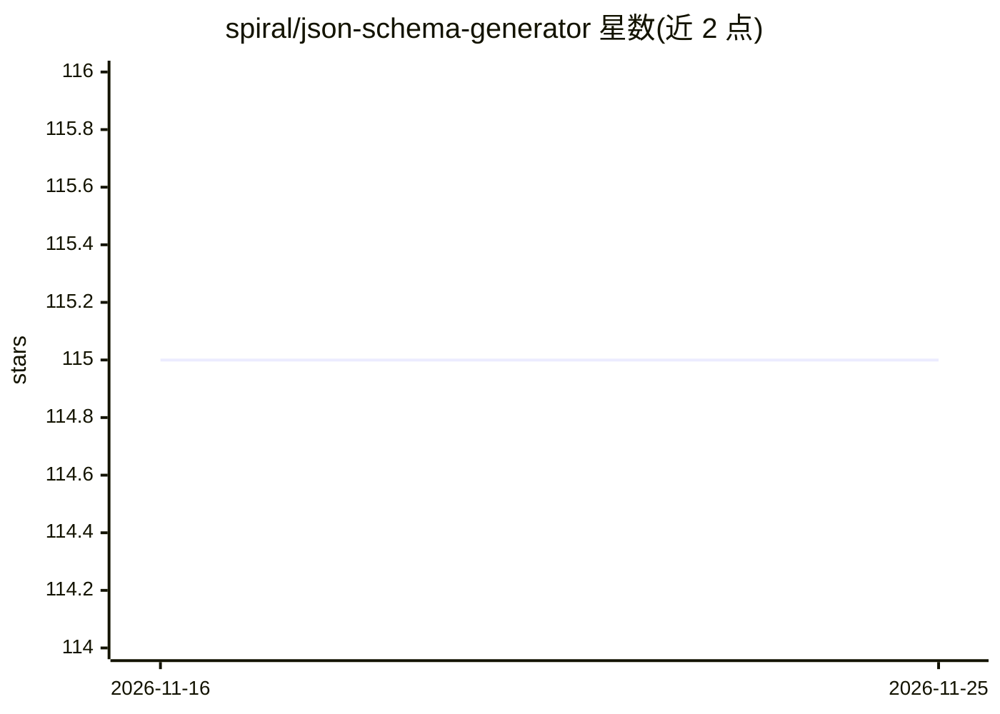

# spiral/json-schema-generator

⭐ 115 · PHP · MIT · 推送 2026-11-23 · [GitHub](https://github.com/spiral/json-schema-generator) · 组织维护

**从 PHP DTO 类生成 JSON Schema，用于 LLM 结构化输出与工具参数**

Spiral 维护的 PHP Composer 包：通过 Generator::generate 读取 DTO 类（含 PHP 8 联合类型、枚举、构造器提升属性），生成 JSON Schema；主要用途是为 LLM 定义结构化输出与工具（function calling）参数。支持从 PHPDoc 注解（array<Movie>、positive-int、shaped array 等）与 PHP 属性（Pattern/Range/Length/Enum/Format 等）提取校验规则，可将 anyOf/oneOf、additionalProperties 写入 schema。属性数据提取器系统可定制约束来源；另给出与 Valinor 映射校验库配合完成数据映射与运行时校验的工作流。限制：需 PHP 环境，schema 生成不涉及模型调用本身。

## 筛选速览

| 维度 | 判定 | 备注 |
|---|---|---|
| AI 角色 | `ai-ecosystem` | LLM/agent 周边工具 |
| 许可风险 | `permissive` | MIT |
| 部署形态 | `None` |  |
| 模型依赖 | — | README 未给出锁定关系 |
| 硬件要求 | — | 无带数字的原话,不猜 |
| 安装摩擦 | `low` | 无编译、无系统依赖或容器化 |
| 成熟度 | — | 结构信号不足 |

## 能力要点

- 从 PHP DTO 类生成 JSON Schema，含联合类型 oneOf 与多态 anyOf
- PHPDoc 注解与 PHP 属性双通道提取校验规则（Pattern/Range/Enum 等 12 种 Format）
- 可定制的属性数据提取器（PropertyDataExtractorInterface）
- 与 Valinor 配合实现同一套约束下的映射与运行时校验

## 适用场景

- 在 PHP 项目中为 LLM 结构化输出/工具参数生成 schema
- 复用同一 DTO 定义生成 API 文档 schema 与运行时数据校验
- 配合 Valinor 完成 JSON 到强类型 DTO 的映射与错误处理

## 场景标签

`代码生成` · 领域:编码与开发

## 证据(README 行号)

> L12: This package generates JSON schemas from Data Transfer Object (DTO) classes. Its main use case is defining structur
> L412: 2. **Schema Generation**: Generate JSON schemas for API documentation or LLM structured output

## 星数曲线

2026-11-16 115 → 2026-11-25 115（+0）

---
*卡片 v1 · prompt 1.4 · 生成 2026-11-17 · 置信度 high · 依据 README sha `fcec627c7c53` · [字段定义](../../DATASET.md)*
