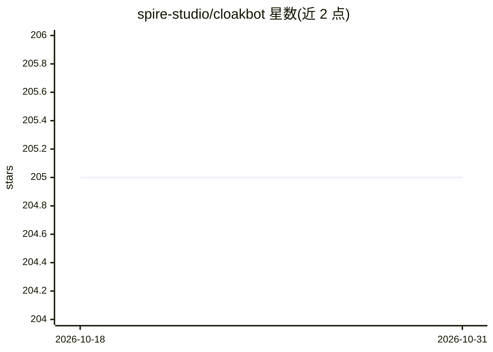

# spire-studio/cloakbot

⭐ 205 · Python · NOASSERTION · 推送 2026-06-18 · [GitHub](https://github.com/spire-studio/cloakbot) · 组织维护 · 中文 README

**本地隐私内核：用本地小模型清洗提示词后再调远程 LLM**

CloakBot 是运行在用户本地的隐私代理层：调用 Claude/GPT/Gemini 等远程 LLM 前，用本地 Gemma 4 E2B 检测器（General + Digit）识别敏感实体（个人信息、证件号、密钥、医疗等），替换为类型化占位符，图片经 OCR+bbox 涂改，长文档分块处理；远程回答流式返回时依据本地 Session Vault 还原原文。检测器可经任意 OpenAI 兼容端点运行（Ollama/vLLM），提供 pip 安装与 WebUI。以 PyPI 包与源码两种方式安装；需自备本地模型端点，检测器指向远程端点会破坏隐私边界（仅限测试）。

## 筛选速览

| 维度 | 判定 | 备注 |
|---|---|---|
| AI 角色 | `ai-ecosystem` | LLM/agent 周边工具 |
| 许可风险 | `none` | NOASSERTION |
| 部署形态 | `library` | 以包/库形式分发 |
| 模型依赖 | local-ok | 支持本地模型 |
| 硬件要求 | `cpu-ok` | |
| 安装摩擦 | `low` | 无编译、无系统依赖或容器化 |
| 成熟度 | `idea` | |

## 能力要点

- 本地 Gemma 4 E2B 检测器并发检测文本/数值敏感实体并生成类型化占位符
- Session Vault 维护占位符↔原文映射，支持跨轮别名复用与本地还原
- 视觉隐私管线：OCR + bbox 涂改 + 占位符覆盖 + 跨模态召回桥接
- 三层端到端泄漏评测（2,872 条实体测试），评测代码可复现

## 适用场景

- 使用 Claude/GPT/Gemini 处理含隐私的文档时避免数据出境
- 在医疗、法律、金融等场景下脱敏调用前沿 LLM
- MacBook 等消费级硬件上无 GPU 搭建本地检测端点（Ollama）

## 场景标签

`网络安全` · 领域:学习与行业

## 证据(README 行号)

> L19: Frontier LLM use is now load-bearing — but the data that crosses the wire is non-revocable. CloakBot moves enforcem
> L128: CloakBot's privacy guarantee depends on the PII detector running **on a host you control**. Any OpenAI-compatible 
> L156: Set the detector's **base URL / API key / model** under `onboard` → **[D] Privacy Detector** (or later in the WebU

## 星数曲线

2026-10-18 205 → 2026-10-31 205（+0）

---
*卡片 v1 · prompt 1.4 · 生成 2026-10-23 · 置信度 mid · 依据 README sha `25592131655c` · [字段定义](../../DATASET.md)*
