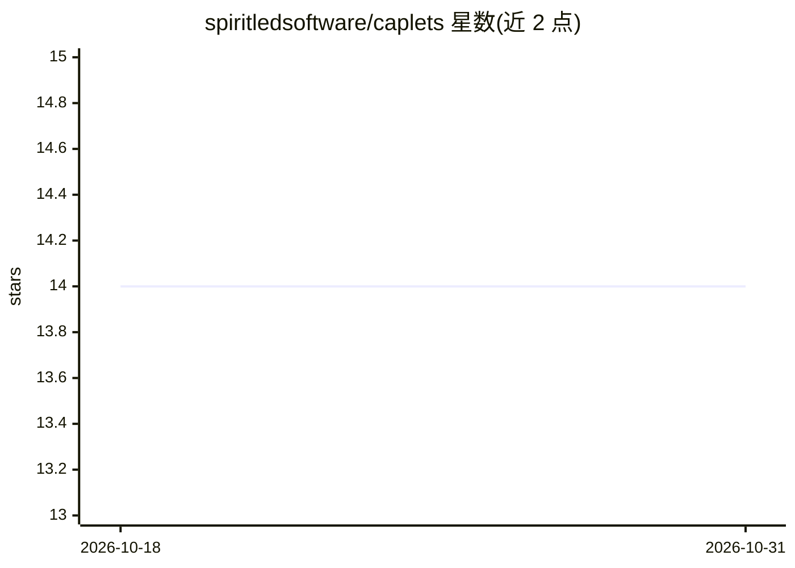

# spiritledsoftware/caplets

⭐ 14 · TypeScript · MIT · 推送 2026-10-17 · [GitHub](https://github.com/spiritledsoftware/caplets) · [官网](https://caplets.dev) · 组织维护

**将 MCP/API/命令封装为能力卡片的编码 agent 工具层**

面向编码 agent 的能力封装层：把 MCP 服务器、OpenAPI/GraphQL/HTTP API 与仓库 CLI 命令包装为类型化的 caplets.<id> 句柄，agent 可在单次工作流中检视、搜索、调用、过滤、连接与汇总，替代把全部下游操作展开为庞大工具列表；Code Mode 为默认暴露方式，也可渐进式暴露为可见工具。架构为守护进程优先：caplets setup 启动本地 daemon 并把 agent 配置为瘦客户端，daemon 负责后端执行、环境、Vault 密钥与重载。通过 npm 安装 CLI，附带 HTTP API、浏览器 dashboard、TypeScript SDK 与共享 Caplet 目录；收集可关闭的匿名遥测。0.26.0 起安装需一次性 SQL 迁移。

## 筛选速览

| 维度 | 判定 | 备注 |
|---|---|---|
| AI 角色 | `ai-ecosystem` | LLM/agent 周边工具 |
| 许可风险 | `permissive` | MIT |
| 部署形态 | `library` | 以包/库形式分发 |
| 模型依赖 | — | README 未给出锁定关系 |
| 硬件要求 | — | 无带数字的原话,不猜 |
| 安装摩擦 | `low` | 无编译、无系统依赖或容器化 |
| 成熟度 | — | 结构信号不足 |

## 能力要点

- 将 MCP/OpenAPI/GraphQL/HTTP/CLI 后端统一为类型化 caplets.<id> 句柄（Code Mode）
- daemon-first 架构：agent 为瘦客户端，密钥保存在加密 Vault 且不暴露给 agent API
- 支持 Codex、Claude Code、OpenCode、Pi 等 MCP 客户端与原生集成
- 提供 @caplets/sdk、HTTP API、dashboard、共享 Caplet 目录与遥测开关

## 适用场景

- 把多个 MCP 服务器与 API 聚合给编码 agent，避免巨型工具列表
- 在 agent 会话内以 Code Mode 一次性完成工具发现、调用与结果汇总
- 以 Vault 集中管理密钥并按授权隔离各 Caplet 的访问

## 场景标签

`Agent 框架` · 领域:Agent 开发

## 证据(README 行号)

> L18: Caplets gives coding agents a Code Mode surface for MCP servers, APIs, and commands. Instead
> L19: of exposing every downstream operation as a giant tool list, each backend becomes a typed
> L20: `caplets.<id>` handle the agent can inspect, search, call, filter, join, and summarize inside

## 星数曲线

2026-10-18 14 → 2026-10-31 14（+0）

---
*卡片 v1 · prompt 1.4 · 生成 2026-10-31 · 置信度 high · 依据 README sha `1d4d5c9e6398` · [字段定义](../../DATASET.md)*
