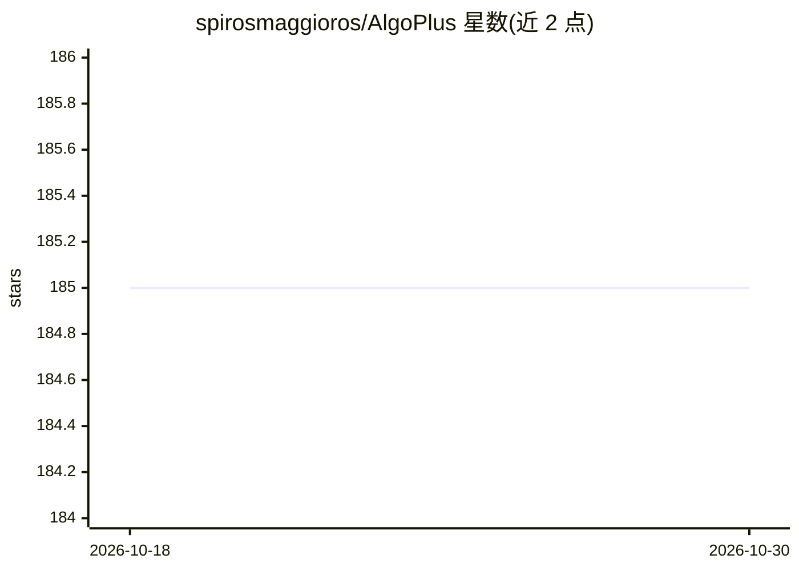

# spirosmaggioros/AlgoPlus

⭐ 185 · C++ · Apache-2.0 · 推送 2026-02-09 · [GitHub](https://github.com/spirosmaggioros/AlgoPlus) · [官网](https://spirosmaggioros.github.io/AlgoPlus) · 个人维护

**C++17 数据结构与算法实现库，含机器学习与图像处理模块**

面向学习与竞赛准备场景的 C++17 算法库，从头实现各类数据结构（红黑树、AVL、Trie、线段树等）、图、列表与算法（动态规划、数论、搜索排序、字符串），并提供机器学习模块（DBSCAN 聚类、编码器、回归、分类、激活/损失函数）与图像处理算法。每个函数配单元测试，通过 CMake 在 Linux/macOS/Windows 构建与运行测试。README 明确声明这是实现集合，不适用于生产或科研环境；Apache 2.0 许可，欢迎贡献。

## 筛选速览

| 维度 | 判定 | 备注 |
|---|---|---|
| AI 角色 | `ai-native` | 本体是模型或模型工具 |
| 许可风险 | `permissive` | Apache-2.0 |
| 部署形态 | `None` |  |
| 模型依赖 | — | README 未给出锁定关系 |
| 硬件要求 | — | 无带数字的原话,不猜 |
| 安装摩擦 | `medium` | 含编译或系统依赖之一 |
| 成熟度 | — | 结构信号不足 |

## 能力要点

- 机器学习模块：聚类/编码器/回归/分类/激活与损失函数
- 十余种树结构（红黑树、AVL、Splay、线段树、Fenwick 等）与多种列表、图、哈希表实现
- 每个函数配套单元测试，支持 Linux/macOS/Windows 的 CMake 构建
- Gitpod Ready-to-Code，代码覆盖率经 codecov 检测

## 适用场景

- 准备算法面试或学习数据结构实现细节
- 参考 DBSCAN 等机器学习算法的 C++ 从零实现
- 在课程或研讨中作为算法实现教学参考

## 场景标签

 · 领域:计算机科学/算法实现

## 证据(README 行号)

> L3: AlgoPlus is a C++ library that includes ready-to-use complex **data structures** and **algorithms** for various topi
> L30: **Machine Learning(NEW!)**
> L26: > This repository is a set of implementations and not a complete library meant for production or research. So whene

## 星数曲线

2026-10-18 185 → 2026-10-30 185（+0）

---
*卡片 v1 · prompt 1.4 · 生成 2026-10-22 · 置信度 mid · 依据 README sha `fdc00e35ad36` · [字段定义](../../DATASET.md)*
