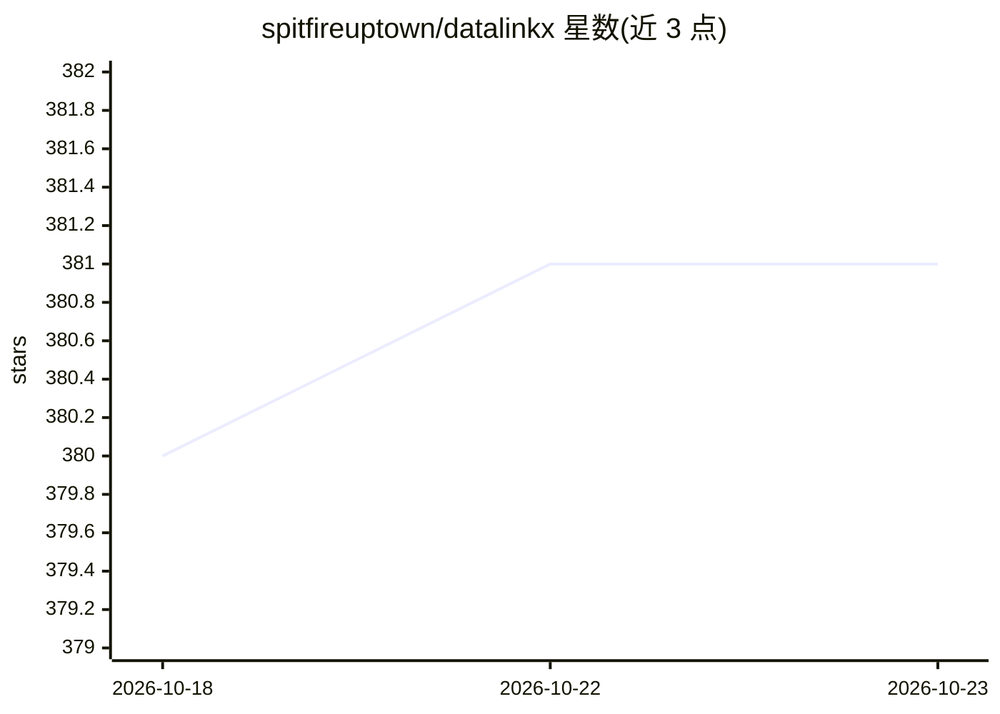

# spitfireuptown/datalinkx

⭐ 381 · Java · NOASSERTION · 推送 2026-06-29 · [GitHub](https://github.com/spitfireuptown/datalinkx) · 个人维护 · 中文 README

**异构数据源同步系统：MySQL/ES/HTTP/Oracle 间全量与增量流转**

基于 Spring Boot 的数据同步服务，通过 Web 页面配置数据源与同步任务，在 MySQL、ElasticSearch、HTTP、Oracle 等异构数据源间进行全量或增量同步，底层依赖 Flink、ChunJun（原 FlinkX）、SeaTunnel 计算引擎。提供批式/实时/计算三类任务、任务级联配置、任务血缘、任务调度（xxl-job cron）与日志采集。计算任务支持 transform 算子，包括 SQL 算子与基于 Ollama 的大模型算子。支持插件化扩展数据源与 Docker 部署，另有付费企业版 DatalinkX-Pro。

## 筛选速览

| 维度 | 判定 | 备注 |
|---|---|---|
| AI 角色 | `ai-enhanced` | 去掉 AI 部分产品仍成立 |
| 许可风险 | `none` | NOASSERTION |
| 部署形态 | `None` |  |
| 模型依赖 | — | README 未给出锁定关系 |
| 硬件要求 | — | 无带数字的原话,不猜 |
| 安装摩擦 | `low` | 无编译、无系统依赖或容器化 |
| 成熟度 | — | 结构信号不足 |

## 能力要点

- 异构数据源（HTTP/Oracle/MySQL/ES 等）间全量与增量同步
- transform 算子支持 SQL 与大模型（Ollama 执行框架）
- 底层依赖 Flink、ChunJun、SeaTunnel 流式计算引擎
- 任务级联配置、任务血缘、xxl-job 定时调度与插件化数据源

## 适用场景

- 定时把业务库数据同步到数仓，集中管理与追溯同步任务
- 在数据流转过程中通过 SQL 或大模型算子做字段转换
- 以画布方式编排计算任务并配置任务级联

## 场景标签

 · 领域:数据工程/数据集成

## 证据(README 行号)

> L38:  **核心功能** ：在不同的异构数据源中进行数据同步，对同步任务进行管理和维护
> L92:  3. 计算任务: 配置画布信息，支持transform算子操作

## 星数曲线

2026-10-18 380 → 2026-10-23 381（+1）

---
*卡片 v1 · prompt 1.4 · 生成 2026-10-21 · 置信度 high · 依据 README sha `a6da897be648` · [字段定义](../../DATASET.md)*
