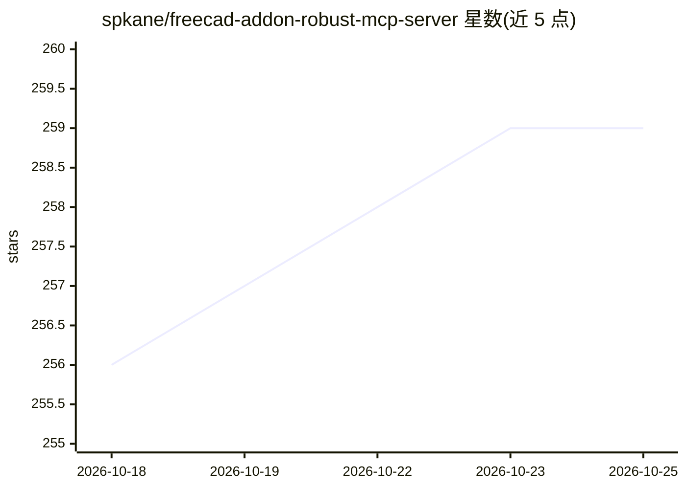

# spkane/freecad-addon-robust-mcp-server

⭐ 259 · Python · MIT · 推送 2026-10-25 · [GitHub](https://github.com/spkane/freecad-addon-robust-mcp-server) · [官网](https://spkane.github.io/freecad-addon-robust-mcp-server/) · 个人维护

**连接 AI 助手与 FreeCAD 的 MCP 服务器及桥接工作台**

MCP (Model Context Protocol) 服务器及配套的 MCP Bridge 工作台/插件，使 Claude、GPT 等 MCP 兼容工具能够操作 FreeCAD，进行 3D 建模、宏开发与调试。提供 150+ 工具，覆盖基元创建、PartDesign 草图、布尔运算、视图控制与文档管理等；支持 XML-RPC、JSON-RPC socket 与 embedded 三种连接模式，支持 GUI 与 headless 运行。要求 FreeCAD 0.21+/1.0+ 与 Python 3.11。

## 筛选速览

| 维度 | 判定 | 备注 |
|---|---|---|
| AI 角色 | `ai-ecosystem` | LLM/agent 周边工具 |
| 许可风险 | `permissive` | MIT |
| 部署形态 | `self-host` | docker 或自建部署 |
| 模型依赖 | — | README 未给出锁定关系 |
| 硬件要求 | — | 无带数字的原话,不猜 |
| 安装摩擦 | `low` | 无编译、无系统依赖或容器化 |
| 成熟度 | — | 结构信号不足 |

## 能力要点

- 150+ MCP 工具覆盖 CAD 操作、草图、布尔运算与宏管理
- 三种连接模式：XML-RPC（推荐）、JSON-RPC socket、embedded（仅 Linux）
- GUI 与 headless 模式均支持建模，GUI 模式额外提供截图与视图控制
- 通过 pip、Docker 或源码安装，配套 FreeCAD Addon Manager 可装的桥接工作台

## 适用场景

- 让 Claude 等 AI 助手辅助编写和调试 FreeCAD 3D 模型与宏
- 用自然语言驱动参数化 CAD 建模
- 在 headless 模式下自动化 FreeCAD 建模流程

## 场景标签

 · 领域:CAD/开发工具

## 证据(README 行号)

> L14: An MCP (Model Context Protocol) server that enables integration between AI assistants (Claude, GPT, and other MCP-c
> L20: - **150+ MCP Tools**: Comprehensive CAD operations including primitives, PartDesign, booleans, export
> L140: Before your AI assistant can connect, you need to start the MCP bridge inside FreeCAD:

## 星数曲线

2026-10-18 256 → 2026-10-25 259（+3）

---
*卡片 v1 · prompt 1.4 · 生成 2026-10-22 · 置信度 high · 依据 README sha `dcae313b6ddd` · [字段定义](../../DATASET.md)*
