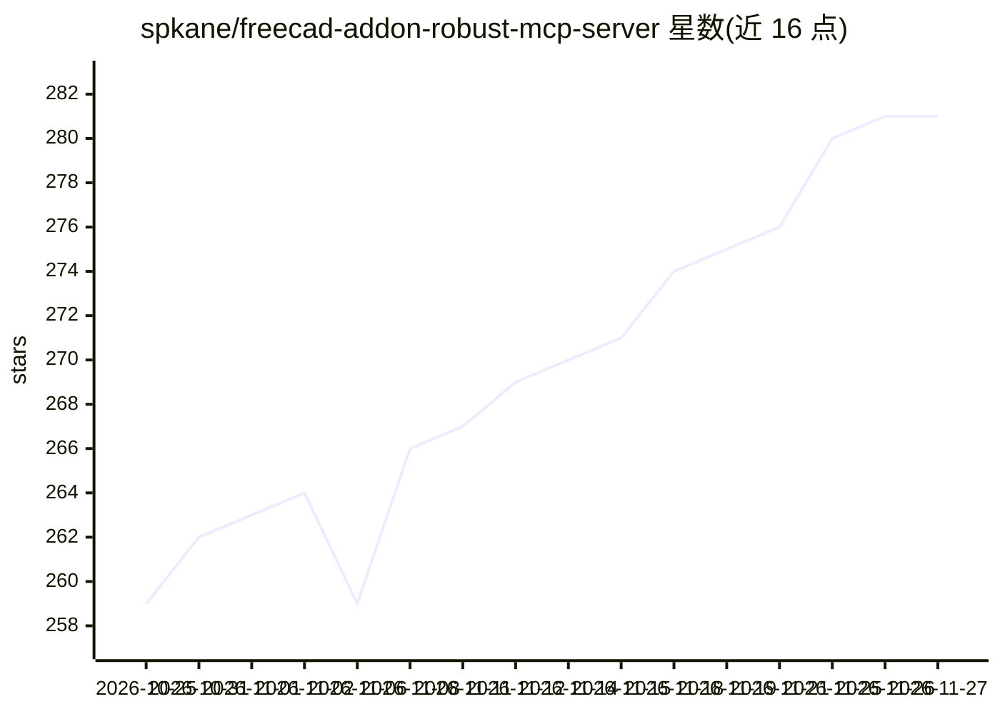

# spkane/freecad-addon-robust-mcp-server

⭐ 281 · Python · Apache-2.0 · 推送 2026-11-26 · [GitHub](https://github.com/spkane/freecad-addon-robust-mcp-server) · [官网](https://spkane.github.io/freecad-addon-robust-mcp-server/) · 个人维护

**连接 AI 助手与 FreeCAD 的 MCP 服务器，AI 辅助 3D 建模调试**

一个 MCP（Model Context Protocol）服务器与配套的 MCP Bridge Workbench 插件，用于在 AI 助手（Claude 等 MCP 兼容客户端）与 FreeCAD 之间建立集成，支持对 3D 模型、宏和工作台进行 AI 辅助开发与调试。提供 150+ MCP 工具覆盖基础建模、PartDesign、布尔运算与导出；支持 JSON-RPC socket（默认，推荐）、XML-RPC 与嵌入式三种连接模式；支持 GUI 与 headless 运行。含配对认证、本地审批对话框、Python 代码审查等安全机制；要求 FreeCAD 1.0.2+ 与 Python 3.11+。

## 筛选速览

| 维度 | 判定 | 备注 |
|---|---|---|
| AI 角色 | `ai-ecosystem` | LLM/agent 周边工具 |
| 许可风险 | `permissive` | Apache-2.0 |
| 部署形态 | `self-host` | docker 或自建部署 |
| 模型依赖 | — | README 未给出锁定关系 |
| 硬件要求 | — | 无带数字的原话,不猜 |
| 安装摩擦 | `low` | 无编译、无系统依赖或容器化 |
| 成熟度 | — | 结构信号不足 |

## 能力要点

- 150+ MCP 工具覆盖 FreeCAD 建模、PartDesign、布尔运算与导出
- 三种连接模式：JSON-RPC socket（默认）、XML-RPC、嵌入式
- 配对认证与本地审批对话框（execute_python/run_macro 等工具需用户确认）
- 支持 GUI 与 headless 模式，GUI 模式可截图与设置颜色

## 适用场景

- 让 Claude Code 等 MCP 客户端辅助编写和调试 FreeCAD 宏
- 通过 AI 助手对 3D 模型执行建模操作与批量导出
- 在 headless/自动化环境中运行 FreeCAD 建模任务

## 场景标签

 · 领域:CAD/AI 工具集成

## 证据(README 行号)

> L14: An MCP (Model Context Protocol) server that enables integration between AI assistants (Claude, GPT, and other MCP-c
> L20: - **150+ MCP Tools**: Comprehensive CAD operations including primitives, PartDesign, booleans, export

## 星数曲线

2026-10-25 259 → 2026-11-27 281（+22）

---
*卡片 v1 · prompt 1.4 · 生成 2026-11-25 · 置信度 high · 依据 README sha `0474553712a0` · [字段定义](../../DATASET.md)*
