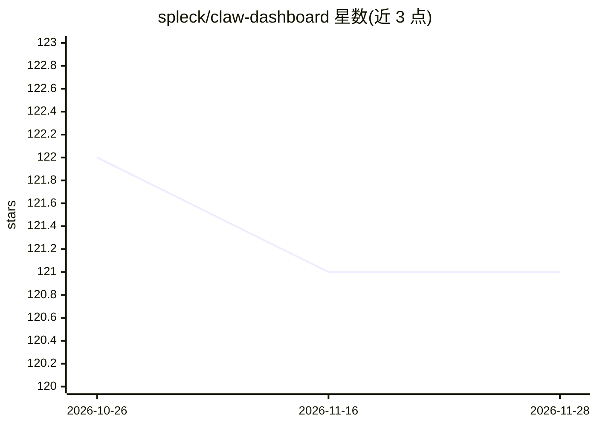

# spleck/claw-dashboard

⭐ 121 · JavaScript · MIT · 推送 2026-11-09 · [GitHub](https://github.com/spleck/claw-dashboard) · [官网](https://www.npmjs.com/package/claw-dashboard) · 个人维护

**为 OpenClaw 网关运维者提供终端实时监控面板**

一个只读的终端 TUI 仪表盘，连接本地运行的 OpenClaw 网关，在单屏展示网关版本、会话与子代理线程状态、上下文压力、token 吞吐、估算成本、cron 自动化任务、活动流与日志尾部。零运行时依赖（仅 Node 内建模块），以 operator.read 只读角色连接，不中止会话、不写任何内容；支持断线自动重连与退避。要求 Node >= 22.19 与 OpenClaw 网关 2026.11+（协议 v4）。

## 筛选速览

| 维度 | 判定 | 备注 |
|---|---|---|
| AI 角色 | `ai-ecosystem` | LLM/agent 周边工具 |
| 许可风险 | `permissive` | MIT |
| 部署形态 | `library` | 以包/库形式分发 |
| 模型依赖 | — | README 未给出锁定关系 |
| 硬件要求 | — | 无带数字的原话,不猜 |
| 安装摩擦 | `low` | 无编译、无系统依赖或容器化 |
| 成熟度 | — | 结构信号不足 |

## 能力要点

- 单屏展示会话线程、自动化任务、活动流与日志尾部
- 零运行时依赖（仅 Node 内建模块），只读访问
- Ed25519 设备密钥对自动配对（loopback 首次配对自动批准）
- 支持 --once 明文快照模式用于脚本与冒烟测试

## 适用场景

- 实时查看 OpenClaw 网关各会话与子代理的运行状态
- 监控 cron 自动化任务的调度与错误
- 在终端按日志级别过滤排障网关问题

## 场景标签

`LLM 可观测性` · 领域:评测与运维

## 证据(README 行号)

> L3: A minimal terminal dashboard for a running OpenClaw gateway — sessions, automations, live activity, and logs on one 
> L17: Requires Node **>= 22.19** (uses the built-in `WebSocket`) and an OpenClaw gateway (2026.11+, protocol v4) running 
> L44: `clawdash` connects with the `operator.read` role and scope **only**. It never aborts sessions, runs crons, or writ

## 星数曲线

2026-10-26 122 → 2026-11-28 121（-1）

---
*卡片 v1 · prompt 1.4 · 生成 2026-11-28 · 置信度 high · 依据 README sha `bf8d3228b81b` · [字段定义](../../DATASET.md)*
