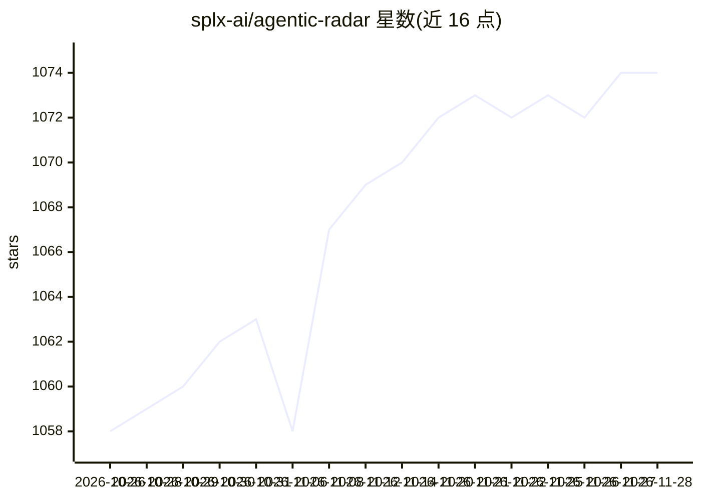

# splx-ai/agentic-radar

⭐ 1,074 · Python · Apache-2.0 · 推送 2026-11-13 · [GitHub](https://github.com/splx-ai/agentic-radar) · [官网](https://splx.ai) · 组织维护

**面向开发者的 LLM agent 工作流安全扫描 CLI**

静态分析 agentic 系统源码，生成包含工作流可视化图、工具清单、MCP server 检测及工具与已知漏洞映射的 HTML 安全报告，并映射到 OWASP LLM Top 10 与 OWASP Agentic AI 威胁框架。扫描在本地运行，代码不上传；可选高级功能（提示词加固、运行时漏洞测试）需设置 OPENAI_API_KEY 或 AZURE_OPENAI_API_KEY。运行时测试注入工作流，用模拟对抗输入检测提示注入、PII 泄露等漏洞，支持 YAML 自定义测试，提供 GitHub Actions CI/CD 集成示例。

## 筛选速览

| 维度 | 判定 | 备注 |
|---|---|---|
| AI 角色 | `ai-ecosystem` | LLM/agent 周边工具 |
| 许可风险 | `permissive` | Apache-2.0 |
| 部署形态 | `library` | 以包/库形式分发 |
| 模型依赖 | — | README 未给出锁定关系 |
| 硬件要求 | — | 无带数字的原话,不猜 |
| 安装摩擦 | `low` | 无编译、无系统依赖或容器化 |
| 成熟度 | — | 结构信号不足 |

## 能力要点

- 静态扫描生成含工作流图、工具识别、MCP 检测、漏洞映射的 HTML 报告
- 支持 LangGraph/CrewAI/n8n/OpenAI Agents/Autogen 五种框架
- 运行时注入对抗输入测试提示注入、PII 泄露、有害内容生成等漏洞，支持 YAML 自定义测试
- 提示词自动加固与 OWASP 框架漏洞映射

## 适用场景

- 扫描 agent 项目源码生成安全评估报告
- 在 CI/CD 流水线中每次推送自动运行安全扫描
- 对 agent 工作流做提示注入与 PII 泄露的运行时测试

## 场景标签

`网络安全` · 领域:学习与行业

## 证据(README 行号)

> L81: The **Agentic Radar** is designed to analyze and assess agentic systems for security and operational insights. It h
> L156: agentic-radar scan [OPTIONS] FRAMEWORK:{langgraph|crewai|n8n|openai-agents|autogen}

## 星数曲线

2026-10-26 1,058 → 2026-11-28 1,074（+16）

---
*卡片 v1 · prompt 1.4 · 生成 2026-11-24 · 置信度 high · 依据 README sha `d0e1d3f95f72` · [字段定义](../../DATASET.md)*
