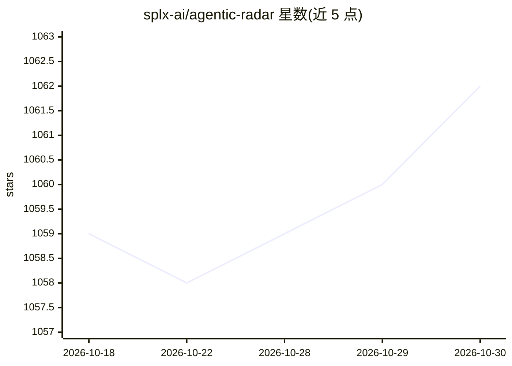

# splx-ai/agentic-radar

⭐ 1,062 · Python · Apache-2.0 · 推送 2025-11-27 · [GitHub](https://github.com/splx-ai/agentic-radar) · [官网](https://splx.ai) · 组织维护

**LLM Agent 工作流安全扫描器：扫描代码生成安全报告**

面向开发者、研究者与安全从业者的 CLI 工具：扫描 agentic 系统代码，生成 HTML 安全报告，内容含工作流可视化图、工具清单、MCP 服务器检测与漏洞映射，并映射到 OWASP Top 10 LLM 与 OWASP Agentic AI 框架。支持 LangGraph、CrewAI、n8n、OpenAI Agents、Autogen 五种框架的静态扫描；高级功能需 OPENAI_API_KEY：提示词加固（重写系统提示词）、运行时对抗测试（提示注入、PII 泄露、有害/假新闻内容等）。静态分析部分本地运行，不上传代码。

## 筛选速览

| 维度 | 判定 | 备注 |
|---|---|---|
| AI 角色 | `ai-ecosystem` | LLM/agent 周边工具 |
| 许可风险 | `permissive` | Apache-2.0 |
| 部署形态 | `library` | 以包/库形式分发 |
| 模型依赖 | — | README 未给出锁定关系 |
| 硬件要求 | — | 无带数字的原话,不猜 |
| 安装摩擦 | `low` | 无编译、无系统依赖或容器化 |
| 成熟度 | — | 结构信号不足 |

## 能力要点

- 扫描代码生成 HTML 报告：工作流图、工具清单、MCP 服务器检测、漏洞映射
- 漏洞映射到 OWASP Top 10 LLM 与 OWASP Agentic AI 框架
- 运行时对抗测试：提示注入、PII 泄露、有害内容、假新闻生成（支持 YAML 自定义测试）
- 提示词加固（--harden-prompts）自动改写系统提示词

## 适用场景

- 为 CrewAI/LangGraph/OpenAI Agents 等 agent 项目做安全审计
- 在 CI/CD 中自动扫描代码库并产出安全报告
- 对 agent 工作流跑提示注入等对抗测试

## 场景标签

`网络安全` `代码审查` · 领域:编码与开发

## 证据(README 行号)

> L81: The **Agentic Radar** is designed to analyze and assess agentic systems for security and operational insights. It h
> L84: 1. **Workflow Visualization** - a graph of the agentic system's workflow✅

## 星数曲线

2026-10-18 1,059 → 2026-10-30 1,062（+3）

---
*卡片 v1 · prompt 1.4 · 生成 2026-10-21 · 置信度 high · 依据 README sha `2d577b683543` · [字段定义](../../DATASET.md)*
