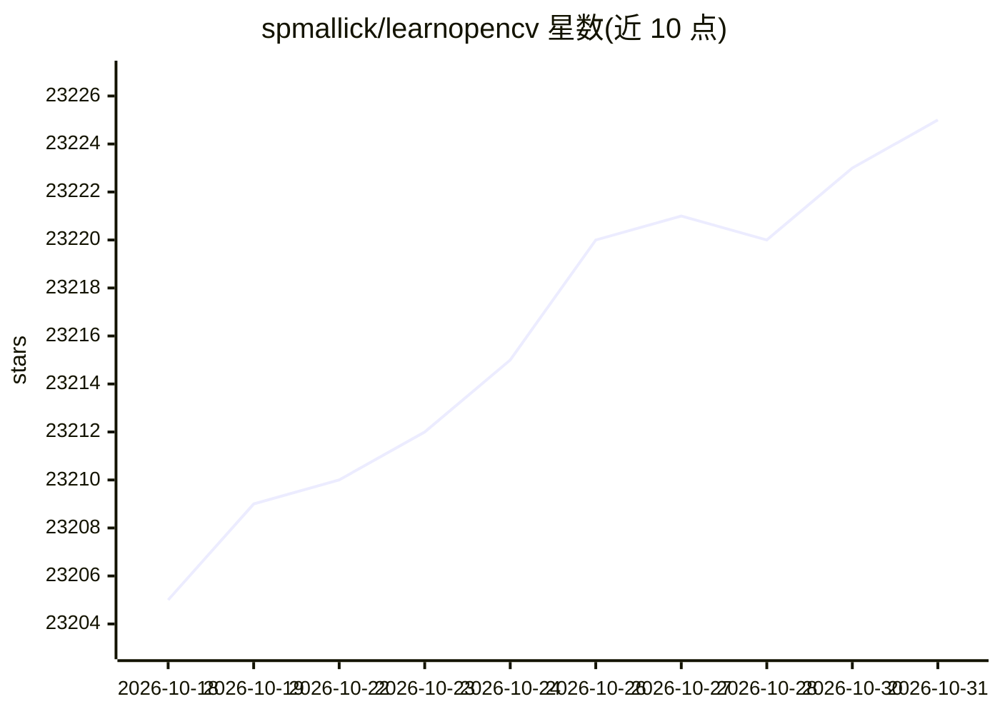

# spmallick/learnopencv

⭐ 23,225 · Jupyter Notebook · 推送 2026-10-22 · [GitHub](https://github.com/spmallick/learnopencv) · [官网](https://www.learnopencv.com/) · 组织维护

**为学习计算机视觉/深度学习的开发者提供博客配套代码示例库**

该仓库收录 LearnOpenCV.com 博客文章对应的 C++ 与 Python 示例代码，主题覆盖 OpenCV 基础操作（图像读写、边缘检测、轮廓、相机标定、光流）、深度学习模型（YOLO 系列、SAM、DETR、CLIP、Gemma、Stable Diffusion 等）以及 3D 重建、SLAM、RAG、VLM、边缘部署等内容。以「博客文章—代码」链接清单为主要组织形式，由 BigVision.AI 公司维护，未在可见 README 中给出统一安装步骤。

## 筛选速览

| 维度 | 判定 | 备注 |
|---|---|---|
| AI 角色 | `ai-knowledge` | 知识聚合/清单类 |
| 许可风险 | `none` | — |
| 部署形态 | `library` | 以包/库形式分发 |
| 模型依赖 | — | README 未给出锁定关系 |
| 硬件要求 | — | 无带数字的原话,不猜 |
| 安装摩擦 | `medium` | 含编译或系统依赖之一 |
| 成熟度 | — | 结构信号不足 |

## 动量与使用信号

- 维护:`active` — 距上次 push 2.2 天,年发版 53,90 位贡献者
- 涨星:近 1 天 **+6**(自 20261016 起算)
- 平台:— · 协议:MCP

## 能力要点

- 博客文章与配套代码一一对应的索引清单
- 覆盖 OpenCV C++/Python 双语言示例
- 内容横跨传统 CV、深度学习、3D 视觉、多模态与边缘部署
- 由 CV 咨询公司 BigVision.AI 维护

## 适用场景

- 查找某个 OpenCV 功能（如相机标定、光流）的可运行示例
- 跟随博客教程跑通 YOLO、SAM 等模型的代码
- 检索 3D 重建、SLAM、RAG 等主题的入门代码

## 场景标签

`教程课程` · 领域:学习与行业

## 证据(README 行号)

> L3: This repository contains code for Computer Vision, Deep learning, and AI research articles shared on our blog LearnO
> L11:  LearnOpenCV is maintained by BigVision.AI , a computer vision and AI consulting company. We help organizations des
> L19: ## List of Blog Posts

## 星数曲线

2026-10-18 23,205 → 2026-10-31 23,225（+20）

---
*卡片 v1 · prompt 1.4 · 生成 2026-10-18 · 置信度 mid · 依据 README sha `1689c90205c4` · [字段定义](../../DATASET.md)*
