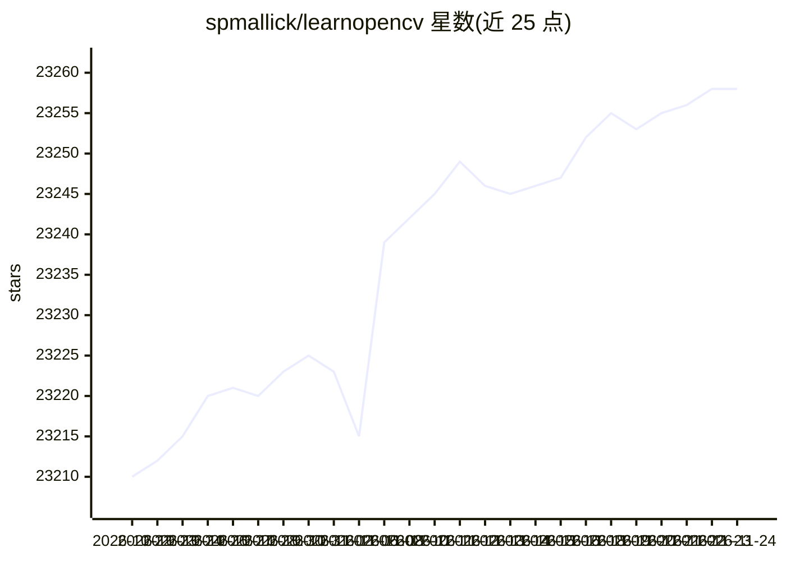

# spmallick/learnopencv

⭐ 23,259 · Jupyter Notebook · 推送 2026-11-20 · [GitHub](https://github.com/spmallick/learnopencv) · [官网](https://www.learnopencv.com/) · 组织维护

**计算机视觉/深度学习博文配套代码示例合集**

LearnOpenCV.com 博客的配套代码仓库，收录大量计算机视觉、深度学习与 AI 研究文章的 C++ 和 Python 示例，覆盖传统 OpenCV 图像处理（边缘检测、相机标定、光流、SLAM）到深度学习主题（目标检测微调、VLM、扩散模型、3D 重建、RAG）等，以博客文章+代码链接的清单形式组织。仓库由 BigVision.AI（计算机视觉与 AI 咨询公司）维护。

## 筛选速览

| 维度 | 判定 | 备注 |
|---|---|---|
| AI 角色 | `ai-knowledge` | 知识聚合/清单类 |
| 许可风险 | `none` | — |
| 部署形态 | `library` | 以包/库形式分发 |
| 模型依赖 | — | README 未给出锁定关系 |
| 硬件要求 | — | 无带数字的原话,不猜 |
| 安装摩擦 | `medium` | 含编译或系统依赖之一 |
| 成熟度 | — | 结构信号不足 |

## 动量与使用信号

- 维护:`active` — 距上次 push 2.2 天,年发版 53,90 位贡献者
- 涨星:近 1 天 **+6**(自 20261016 起算)
- 平台:— · 协议:MCP

## 能力要点

- C++ 与 Python 双语言的 OpenCV 教程代码示例
- 覆盖传统 CV 技术与深度学习、多模态、3D 重建等研究方向
- 以博文清单形式组织，每条附 Code 链接
- 由 BigVision.AI 计算机视觉咨询公司维护

## 适用场景

- 按教程学习 OpenCV 图像处理的 C++/Python 实现
- 查找目标检测、分割、深度估计等任务的参考代码
- 了解深度学习与计算机视觉研究方向的代码实践

## 场景标签

`教程课程` `图像视频处理` `目标检测` · 领域:学习与行业

## 证据(README 行号)

> L3: This repository contains code for Computer Vision, Deep learning, and AI research articles shared on our blog LearnO
> L19: ## List of Blog Posts

## 星数曲线

2026-10-22 23,210 → 2026-11-24 23,258（+48）

---
*卡片 v1 · prompt 1.4 · 生成 2026-11-22 · 置信度 mid · 依据 README sha `eb81035d15d4` · [字段定义](../../DATASET.md)*
