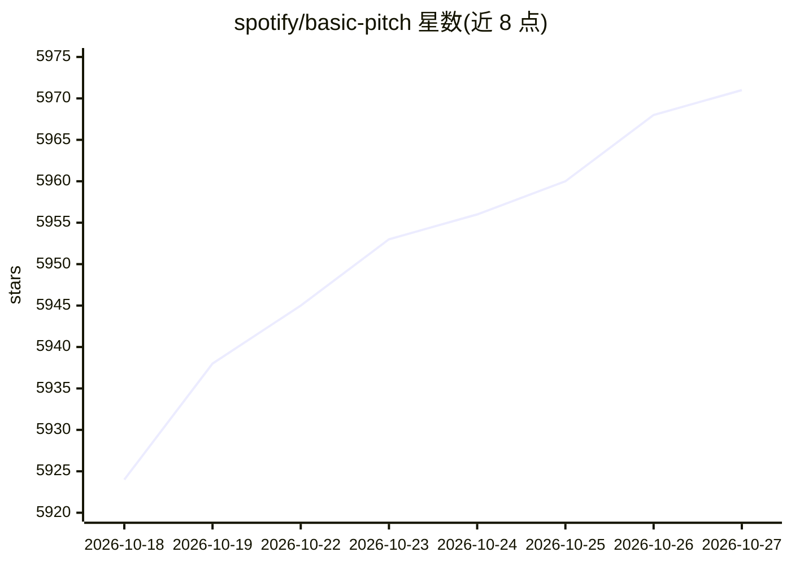

# spotify/basic-pitch

⭐ 5,971 · Python · Apache-2.0 · 推送 2025-11-13 · [GitHub](https://github.com/spotify/basic-pitch) · [官网](https://basicpitch.io) · 组织维护

**Spotify 的轻量音频转 MIDI 自动音乐转录库**

Spotify Audio Intelligence Lab 开发的 Python 库，用轻量神经网络做自动音乐转录（AMT）：输入音频文件，输出带 pitch bend 的 MIDI 及音符事件。模型与乐器无关，支持多音轨/复音乐器，单乐器效果最好。模型以 TensorFlow 为原始格式，并转换为 CoreML/TensorFlowLite/ONNX 运行时，按平台默认安装；支持 CLI 与 Python API 两种使用方式。立体声输入会降混为单声道，统一重采样至 22050 Hz。

## 筛选速览

| 维度 | 判定 | 备注 |
|---|---|---|
| AI 角色 | `ai-native` | 本体是模型或模型工具 |
| 许可风险 | `permissive` | Apache-2.0 |
| 部署形态 | `library` | 以包/库形式分发 |
| 模型依赖 | — | README 未给出锁定关系 |
| 硬件要求 | — | 无带数字的原话,不猜 |
| 安装摩擦 | `low` | 无编译、无系统依赖或容器化 |
| 成熟度 | — | 结构信号不足 |

## 能力要点

- 音频→MIDI 转录，含 pitch bend 输出
- 支持复音乐器、与乐器无关的模型
- 多运行时：TensorFlow/CoreML/TensorFlowLite/ONNX，按平台默认选择
- 提供 CLI 与 Python predict()/predict_and_save() 接口

## 适用场景

- 把录音或哼唱转成 MIDI 进行编曲
- 批量处理音频文件生成音符事件/CSV 供分析
- 在自己的 Python 项目中集成音乐转录功能

## 场景标签

 · 领域:音频/音乐信息检索

## 证据(README 行号)

> L7: Basic Pitch is a Python library for Automatic Music Transcription (AMT), using lightweight neural network developed 
> L11: Provide a compatible audio file and basic-pitch will generate a MIDI file, complete with pitch bends. Basic pitch i
> L14: This library was released in conjunction with Spotify's publication at ICASSP 2022. You can read more about this re

## 星数曲线

2026-10-18 5,924 → 2026-10-27 5,971（+47）

---
*卡片 v1 · prompt 1.4 · 生成 2026-10-20 · 置信度 mid · 依据 README sha `c310c48b4baa` · [字段定义](../../DATASET.md)*
