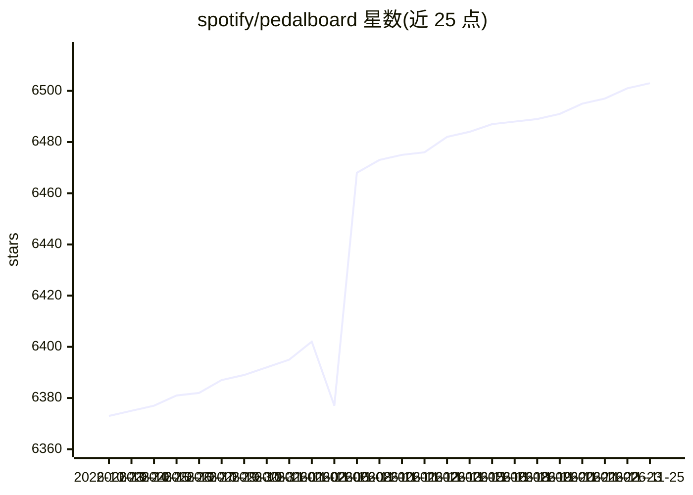

# spotify/pedalboard

⭐ 6,503 · C++ · GPL-3.0 · 推送 2026-11-09 · [GitHub](https://github.com/spotify/pedalboard) · [官网](https://spotify.github.io/pedalboard) · 组织维护

**Spotify 出品的 Python 音频效果与 I/O 处理库**

由 Spotify Audio Intelligence Lab 开发的 Python 音频库，功能覆盖音频文件读写（AIFF/FLAC/MP3/OGG/WAV 等格式，无额外依赖）、实时重采样、内置多种效果器（合唱/失真/压缩/混响/变调等）、实时音频流处理，并可加载 VST3 与 Audio Unit 第三方插件。设计上兼容 TensorFlow 的 tf.data 管线，常用于机器学习训练数据增强。通过 PyPI 安装，支持 Linux/macOS/Windows 的预编译 wheel，释放 GIL 以利用多核 CPU。

## 筛选速览

| 维度 | 判定 | 备注 |
|---|---|---|
| AI 角色 | `ai-ecosystem` | LLM/agent 周边工具 |
| 许可风险 | `viral` | GPL-3.0 |
| 部署形态 | `library` | 以包/库形式分发 |
| 模型依赖 | — | README 未给出锁定关系 |
| 硬件要求 | — | 无带数字的原话,不猜 |
| 安装摩擦 | `low` | 无编译、无系统依赖或容器化 |
| 成熟度 | — | 结构信号不足 |

## 能力要点

- 多格式音频读写与 O(1) 内存实时重采样
- 内置吉他/响度/滤波/空间/变调等多类效果器
- 支持加载 VST3 与 Audio Unit 第三方插件
- 兼容 TensorFlow tf.data 管线并释放 GIL 支持多线程

## 适用场景

- 为机器学习模型做音频数据增强
- 在 Python 中给音频添加效果而无需 DAW
- 实时处理直播或录音输入流
- 在 tf.data 训练管线中读取和变换音频

## 场景标签

`图像视频处理` · 领域:感知与多模态

## 证据(README 行号)

> L15: `pedalboard` is a Python library for working with audio: reading, writing, rendering, adding effects, and more. It 
> L17: `pedalboard` was built by Spotify's Audio Intelligence Lab to enable using studio-quality audio effects from within
> L44:  - Tested compatibility with TensorFlow - can be used in `tf.data` pipelines!

## 星数曲线

2026-10-23 6,373 → 2026-11-25 6,503（+130）

---
*卡片 v1 · prompt 1.4 · 生成 2026-11-22 · 置信度 high · 依据 README sha `982736f1dbf6` · [字段定义](../../DATASET.md)*
