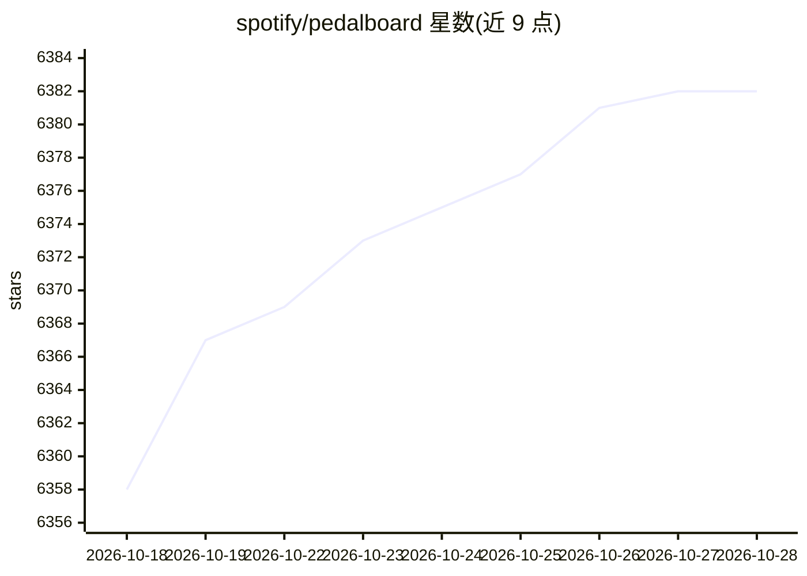

# spotify/pedalboard

⭐ 6,382 · C++ · GPL-3.0 · 推送 2026-10-23 · [GitHub](https://github.com/spotify/pedalboard) · [官网](https://spotify.github.io/pedalboard) · 组织维护

**Python 音频处理库：读写/加效果/加载 VST3 插件**

由 Spotify Audio Intelligence Lab 开发的 Python 音频库：内置音频 I/O（支持 AIFF/FLAC/MP3/OGG/WAV 等格式）、多种音频效果（混响、压缩、音高变换、比特压缩等）以及 VST3 与 Audio Unit 插件加载；支持实时音频流处理与 tf.data 管道。Spotify 内部用于机器学习数据增强及 AI DJ 等功能，也可脱离 DAW 进行音频内容创作。通过 PyPI 平台 wheel 安装，释放 GIL 以利用多核 CPU；Linux x86_64 wheel 需要 AVX 支持。

## 筛选速览

| 维度 | 判定 | 备注 |
|---|---|---|
| AI 角色 | `ai-ecosystem` | LLM/agent 周边工具 |
| 许可风险 | `viral` | GPL-3.0 |
| 部署形态 | `library` | 以包/库形式分发 |
| 模型依赖 | — | README 未给出锁定关系 |
| 硬件要求 | — | 无带数字的原话,不猜 |
| 安装摩擦 | `low` | 无编译、无系统依赖或容器化 |
| 成熟度 | — | 结构信号不足 |

## 能力要点

- 内置多种音频效果（吉他效果、均衡器、混响、音高变换、有损压缩等）
- 支持加载 VST3 与 macOS Audio Unit 第三方插件
- AudioStream 实时音频流处理，释放 GIL 支持多核
- 无依赖读写 AIFF/FLAC/MP3/OGG/WAV，支持 O(1) 内存重采样

## 适用场景

- 为机器学习模型训练做音频数据增强
- 在 Python 中加载 VST3/AU 插件处理音频，无需 DAW
- 构建实时音频效果链或并行效果处理

## 场景标签

 · 领域:音频处理/机器学习工具

## 证据(README 行号)

> L17: `pedalboard` was built by Spotify's Audio Intelligence Lab to enable using studio-quality audio effects from within
> L44:  - Tested compatibility with TensorFlow - can be used in `tf.data` pipelines!

## 星数曲线

2026-10-18 6,358 → 2026-10-28 6,382（+24）

---
*卡片 v1 · prompt 1.4 · 生成 2026-10-20 · 置信度 high · 依据 README sha `0808598db7cd` · [字段定义](../../DATASET.md)*
