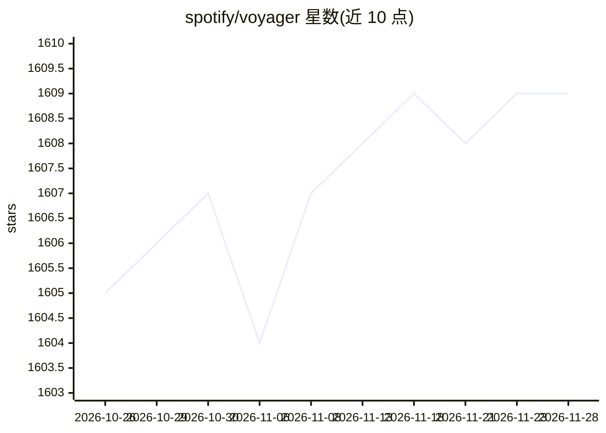

# spotify/voyager

⭐ 1,609 · C++ · Apache-2.0 · 推送 2026-11-16 · [GitHub](https://github.com/spotify/voyager) · [官网](https://spotify.github.io/voyager/) · 组织维护

**Python/Java 内存向量近似最近邻搜索库**

Spotify 开源的近似最近邻搜索库，对内存中的向量集合执行 HNSW 检索，基于开源 hnswlib 并在便捷性与速度上做了扩展。提供 Python 与 Java 双绑定，两语言间功能对等且索引兼容，另有 Scala artifact；在 Spotify 生产环境中使用，每日被查询数亿次。安装通过 pip 或 Maven/sbt 依赖，提供 Linux/macOS/Windows 的 x86_64 与 arm64 预编译 wheel，free-threaded Python 构建暂不支持。

## 筛选速览

| 维度 | 判定 | 备注 |
|---|---|---|
| AI 角色 | `ai-native` | 本体是模型或模型工具 |
| 许可风险 | `permissive` | Apache-2.0 |
| 部署形态 | `desktop` | 安装包/桌面程序 |
| 模型依赖 | — | README 未给出锁定关系 |
| 硬件要求 | — | 无带数字的原话,不猜 |
| 安装摩擦 | `low` | 无编译、无系统依赖或容器化 |
| 成熟度 | — | 结构信号不足 |

## 能力要点

- 基于 HNSW 算法（hnswlib）的内存向量近似最近邻检索
- Python 与 Java 双绑定，索引互相兼容
- 提供 pip 安装与 Maven/sbt 依赖引入
- 支持 Linux/macOS/Windows 的 x86_64 与 arm64 预编译包

## 适用场景

- 对 embedding 向量做快速近邻检索
- Python 与 Java 服务间共享向量索引
- 部署推荐/相似度检索功能且希望无重型编译依赖

## 场景标签

`向量数据库` · 领域:知识与检索

## 证据(README 行号)

> L9: **_Voyager_** is a library for performing fast approximate nearest-neighbor searches on an in-memory collection of v
> L11: Voyager features bindings to both Python and Java, with feature parity and index compatibility between both languag

## 星数曲线

2026-10-26 1,605 → 2026-11-28 1,609（+4）

---
*卡片 v1 · prompt 1.4 · 生成 2026-11-23 · 置信度 high · 依据 README sha `02c377266599` · [字段定义](../../DATASET.md)*
