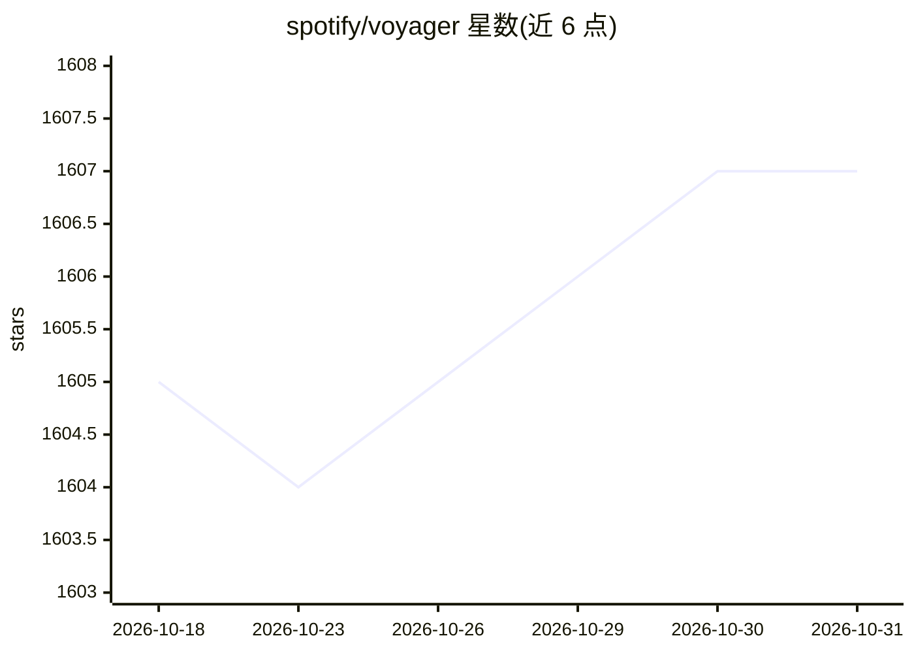

# spotify/voyager

⭐ 1,607 · C++ · Apache-2.0 · 推送 2026-10-20 · [GitHub](https://github.com/spotify/voyager) · [官网](https://spotify.github.io/voyager/) · 组织维护

**面向向量嵌入的内存近似最近邻搜索库（Python/Java）**

Spotify 开源的近似最近邻搜索库，对内存中的向量集合执行快速 ANN 检索，基于开源 hnswlib 的 HNSW 算法实现，增加多项便捷与速度特性。提供 Python 与 Java 绑定，两种语言功能对等且索引格式互相兼容，另可在 Scala 中经 Maven 坐标使用。README 称其在 Spotify 生产环境广泛使用，每日响应数亿次查询。支持 Linux/macOS 的 x86_64 与 arm64，Windows 仅支持 x86_64；macOS 与 Linux 支持 Apple Silicon（Docker 内）。

## 筛选速览

| 维度 | 判定 | 备注 |
|---|---|---|
| AI 角色 | `ai-ecosystem` | LLM/agent 周边工具 |
| 许可风险 | `permissive` | Apache-2.0 |
| 部署形态 | `desktop` | 安装包/桌面程序 |
| 模型依赖 | — | README 未给出锁定关系 |
| 硬件要求 | — | 无带数字的原话,不猜 |
| 安装摩擦 | `low` | 无编译、无系统依赖或容器化 |
| 成熟度 | — | 结构信号不足 |

## 能力要点

- HNSW 算法的内存向量近似最近邻检索
- Python 与 Java 绑定功能对等、索引互相兼容
- pip / Maven / sbt 三种安装途径
- Spotify 生产环境使用，日查询量数亿次

## 适用场景

- 在 Python 或 Java 服务中对嵌入向量做高效相似度检索
- 跨 Python/Java 技术栈共享同一份 ANN 索引
- 为推荐、检索类用户功能提供向量查询底层组件

## 场景标签

`向量数据库` · 领域:知识与检索

## 证据(README 行号)

> L9: **_Voyager_** is a library for performing fast approximate nearest-neighbor searches on an in-memory collection of v
> L11: Voyager features bindings to both Python and Java, with feature parity and index compatibility between both languag

## 星数曲线

2026-10-18 1,605 → 2026-10-31 1,607（+2）

---
*卡片 v1 · prompt 1.4 · 生成 2026-10-21 · 置信度 high · 依据 README sha `22748df92163` · [字段定义](../../DATASET.md)*
