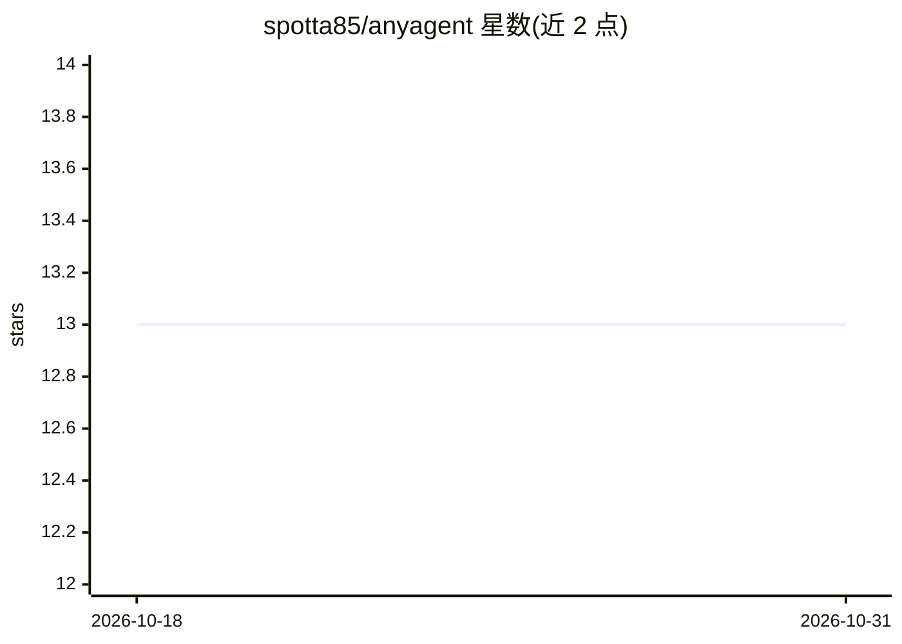

# spotta85/anyagent

⭐ 13 · Rust · Apache-2.0 · 推送 2026-10-08 · [GitHub](https://github.com/spotta85/anyagent) · [官网](https://spotta85.github.io/anyagent-landing/) · 个人维护

**Rust crate：用统一接口驱动本机已装的多个编码 agent**

面向构建 agent 应用的开发者：anyagent 发现并管理用户机器上已安装的编码 agent（Claude Code、Codex、Cursor、Grok、OpenCode 等），通过各自的原生协议或 ACP 与之通信，暴露统一的类型化 API（Runtime、Session、Event 流）。功能含登录探测、配额查询、一次性文本生成、会话恢复/分叉/回滚、自定义 MCP Server、mock 测试等。以 crates.io Rust crate 分发，附 CLI（list/chat/serve，serve 以 JSON lines 供其他语言使用）。限早期版本（0.0.5），支持 agent 目录见 README 表格。

## 筛选速览

| 维度 | 判定 | 备注 |
|---|---|---|
| AI 角色 | `ai-ecosystem` | LLM/agent 周边工具 |
| 许可风险 | `permissive` | Apache-2.0 |
| 部署形态 | `library` | 以包/库形式分发 |
| 模型依赖 | — | README 未给出锁定关系 |
| 硬件要求 | — | 无带数字的原话,不猜 |
| 安装摩擦 | `low` | 无编译、无系统依赖或容器化 |
| 成熟度 | — | 结构信号不足 |

## 能力要点

- 统一 Runtime/Session/Events API 覆盖 9+ 种编码 agent（原生协议或 ACP）
- 会话恢复、分叉、回滚与中途转向/取消
- Runtime::with_mock 支持无子进程的脚本化测试
- anyagent serve 以 JSON lines 协议供非 Rust 语言调用

## 适用场景

- 构建自己的聊天 UI/应用时复用用户已有的 AI 订阅
- 避免为每个编码 agent 维护一套驱动适配层
- 跨 agent 统一处理权限请求、工具调用与事件流

## 场景标签

`Agent 框架` `模型网关` · 领域:Agent 开发

## 证据(README 行号)

> L15: anyagent is that layer, **once: it finds the agents, speaks each one's protocol
> L16: (native or ACP), and gives you one typed
> L19: #### Your app keeps its own transcript, UI, and policy. anyagent owns the processes, the wires, and the turn rules 

## 星数曲线

2026-10-18 13 → 2026-10-31 13（+0）

---
*卡片 v1 · prompt 1.4 · 生成 2026-10-31 · 置信度 high · 依据 README sha `8bf99e9bc3c4` · [字段定义](../../DATASET.md)*
