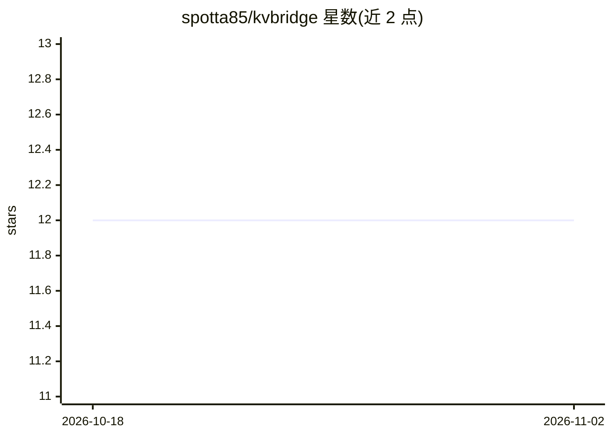

# spotta85/kvbridge

⭐ 12 · Python · MIT · 推送 2026-08-11 · [GitHub](https://github.com/spotta85/kvbridge) · 个人维护

**跨模型 KV cache 迁移库：小模型预填充、大模型作答**

基于论文《Cross-Model KV Cache Transfer in LLM Families》(Heo et al., NVIDIA) 的独立实现：通过离线拟合的逐层岭回归线性映射，把一个小模型（如 Qwen3-1.7B）的 KV cache 转换为大模型（如 Qwen3-4B）可用的格式，从而省去大模型对同一 prompt 的重复预填充，16K 上下文映射耗时 290 ms（对比 1270 ms 预填充），保留 4B 基准 83.7% 的准确率。基于 HuggingFace DynamicCache 运行，提供预拟合 mapper、自拟合接口与本地基准框架。限制：仅支持匹配 KV 几何的模型对（相同 num_key_value_heads 与 head_dim）、batch size 1、仅稠密模型、长上下文保留率下降、mapper 文件较大（k=12 约 1.8 GB）、端到端仅验证一对模型。

## 筛选速览

| 维度 | 判定 | 备注 |
|---|---|---|
| AI 角色 | `ai-ecosystem` | LLM/agent 周边工具 |
| 许可风险 | `permissive` | MIT |
| 部署形态 | `library` | 以包/库形式分发 |
| 模型依赖 | — | README 未给出锁定关系 |
| 硬件要求 | — | 无带数字的原话,不猜 |
| 安装摩擦 | `medium` | 含编译或系统依赖之一 |
| 成熟度 | — | 结构信号不足 |

## 能力要点

- 线性映射转换 KV cache：小模型读文档、大模型作答，16K 上下文 290 ms 对比 1270 ms 预填充
- 提供 Hub 预拟合 mapper 与 fit_mapper 自拟合接口（约 20 分钟、单 A100 可完成）
- 本地设备无关基准框架（Mac/CUDA/CPU），含 mapped/hybrid/layers 多种缓存策略与四个探针任务
- fit 前检查校准行数与 RAM，拒绝会产生虚假 R² 的拟合；27 个单元测试覆盖核心不变量

## 适用场景

- 多模型服务栈中让小模型承担长文档预填充，降低大模型推理成本
- 为同一模型家族内的模型对（如 Qwen3 系列）自拟合 KV 映射并复现基准
- 研究 KV cache 迁移的保真度衰减与混合策略（sink+window）效果

## 场景标签

`推理引擎` · 领域:训练与推理

## 证据(README 行号)

> L55: kvbridge is an independent implementation of that method packaged as something you can actually call, plus a fitted
> L57: so there is no serving engine to adopt: if you can call `model.generate`, you
> L264: pip install -e . pytest && pytest        # 27 tests, ~3 s, CPU only

## 星数曲线

2026-10-18 12 → 2026-11-02 12（+0）

---
*卡片 v1 · prompt 1.4 · 生成 2026-11-01 · 置信度 mid · 依据 README sha `fea08b4882f0` · [字段定义](../../DATASET.md)*
