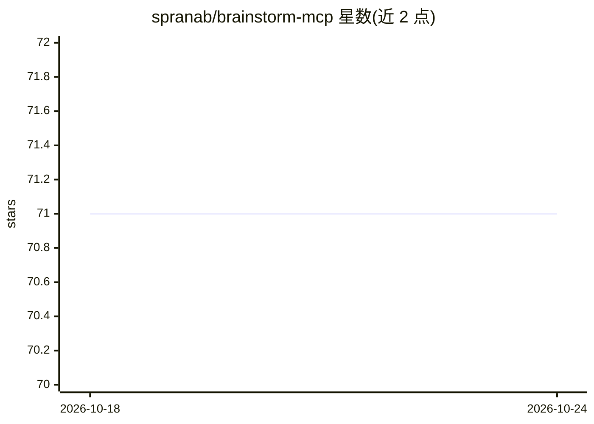

# spranab/brainstorm-mcp

⭐ 71 · TypeScript · MIT · 推送 2026-09-29 · [GitHub](https://github.com/spranab/brainstorm-mcp) · [官网](https://www.npmjs.com/package/brainstorm-mcp) · 个人维护

**多模型多轮辩论的 MCP 服务器，输出结构化综合结论**

面向在编辑器/Claude Code 中工作的开发者的 MCP 服务器：让 GPT、Gemini、DeepSeek、Claude、Groq 及本地 Ollama 模型就同一问题进行多轮辩论（互相查看并批评对方回答），最终由综合模型输出 3 条要点的结论（建议、关键权衡、最大分歧）。提供托管模式（零 API key，由宿主 Claude Code 生成子代理执行）、API 模式与 CLI 模式（复用已有 agent CLI 订阅而非 API 计费），另含快速多模型对比、带严重度评级的多模型代码评审、红队/苏格拉底辩论风格。单模型失败不中断辩论，macOS/Windows/Linux 跨平台，本地运行不收集数据。

## 筛选速览

| 维度 | 判定 | 备注 |
|---|---|---|
| AI 角色 | `ai-native` | 本体是模型或模型工具 |
| 许可风险 | `permissive` | MIT |
| 部署形态 | `library` | 以包/库形式分发 |
| 模型依赖 | local-ok | 支持本地模型 |
| 硬件要求 | — | 无带数字的原话,不猜 |
| 安装摩擦 | `low` | 无编译、无系统依赖或容器化 |
| 成熟度 | — | 结构信号不足 |

## 能力要点

- 多轮辩论：模型跨轮互相批评对方回答后输出 3 要点综合结论
- 托管模式零 API key，由宿主 Claude Code 子代理执行提示词
- CLI 模式自动检测 PATH 上的 agent CLI，用订阅代替 API 计费
- brainstorm_review 多模型代码评审：严重度、结论与模型一致性分析

## 适用场景

- 让多个模型辩论技术选型（如 GraphQL vs REST）并给出结构化结论
- 对 diff 做多模型安全/正确性代码评审
- 10 秒内获取多模型对同一问题的并行对比观点

## 场景标签

 · 领域:LLM 工具/MCP 基础设施

## 证据(README 行号)

> L13: brainstorm-mcp runs multi-round debates between GPT, Gemini, DeepSeek, Claude
> L43: - **Hosted mode** — No API keys needed. Uses models in your environment (Claude Opus/Sonnet/Haiku) via sub-agents
> L230: |`brainstorm`|Multi-round debate between AI models (API or hosted mode)|readOnly|

## 星数曲线

2026-10-18 71 → 2026-10-24 71（+0）

---
*卡片 v1 · prompt 1.4 · 生成 2026-10-24 · 置信度 high · 依据 README sha `7b0a2fce1432` · [字段定义](../../DATASET.md)*
