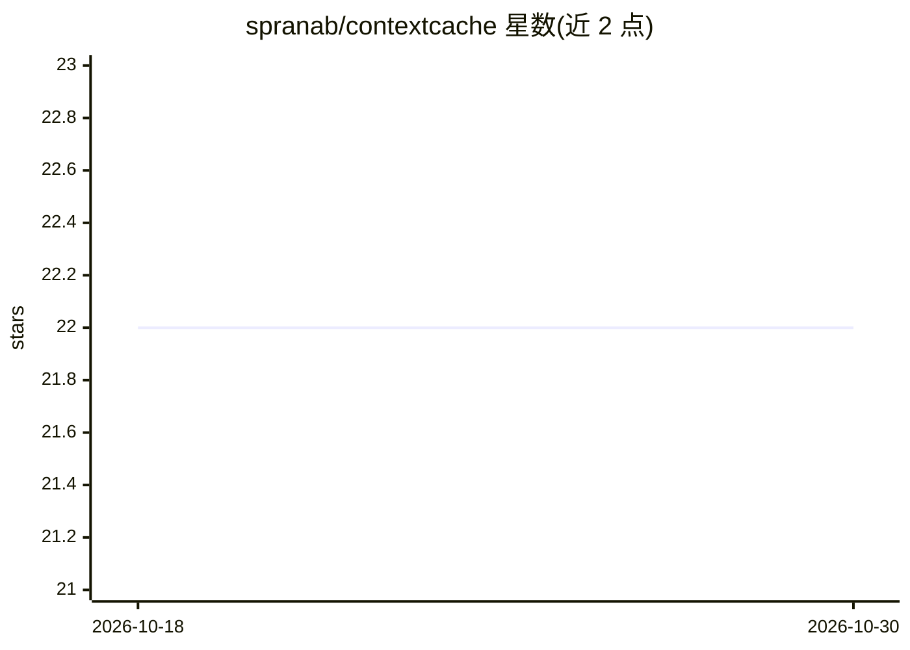

# spranab/contextcache

⭐ 22 · Python · NOASSERTION · 推送 2026-09-16 · [GitHub](https://github.com/spranab/contextcache) · [官网](https://github.com/spranab/contextcache) · 个人维护

**给 LLM 工具调用开发者的 KV 缓存中间件：缓存工具 schema 预填充**

开源中间件服务，将工具调用 LLM 请求中重复预填充的工具 schema 编译为 KV 缓存，按 SHA-256 内容寻址存储于磁盘并跨用户、会话复用，使 TTFT 在 50 工具时保持约 200ms（Qwen3-8B、RTX 3090 Ti 基准）。提供 GPU（PyTorch+transformers，约 8GB 显存）与 CPU（llama.cpp 运行 Qwen3.5-2B GGUF）两种后端，后者可配合 Ollama/Claude/OpenAI 做参数抽取与综合。通过 git clone 源码安装，SDK 未发布 PyPI；提供 REST API 与浏览器管理界面，兼容 OpenAI function-calling 工具格式。

## 筛选速览

| 维度 | 判定 | 备注 |
|---|---|---|
| AI 角色 | `ai-ecosystem` | LLM/agent 周边工具 |
| 许可风险 | `none` | NOASSERTION |
| 部署形态 | `library` | 以包/库形式分发 |
| 模型依赖 | local-ok | 支持本地模型 |
| 硬件要求 | `gpu-8g` | |
| 安装摩擦 | `medium` | 含编译或系统依赖之一 |
| 成熟度 | — | 结构信号不足 |

## 能力要点

- 工具 schema 组缓存编译为 KV 状态，磁盘内容寻址存储，跨用户/会话复用
- GPU 后端（PyTorch，约 8GB VRAM）与 CPU 编排后端（llama.cpp + Qwen3.5-2B GGUF）两种模式
- 路由/完整流水线两类产品：工具选择+置信度，或路由→参数抽取→执行→综合
- 服务器端 LLM 凭据管理与浏览器管理面板

## 适用场景

- 工具数量多的 agent 系统降低首字延迟与重复预填充开销
- 无 GPU 环境下用小模型做快速工具路由，外部 LLM 做参数抽取
- 多租户共享工具集时复用同一缓存避免重复计算

## 场景标签

`推理引擎` · 领域:训练与推理

## 证据(README 行号)

> L8: ContextCache is an open-source middleware that caches the KV states of tool definitions so they don't get recomputed
> L26: ContextCache compiles those tool schemas into a KV cache **once**, stores it on disk, and reuses it across all requ
> L153: ContextCache offers two inference backends. Both cache tool schemas as KV states for fast routing — the difference

## 星数曲线

2026-10-18 22 → 2026-10-30 22（+0）

---
*卡片 v1 · prompt 1.4 · 生成 2026-10-27 · 置信度 mid · 依据 README sha `c805c4155488` · [字段定义](../../DATASET.md)*
