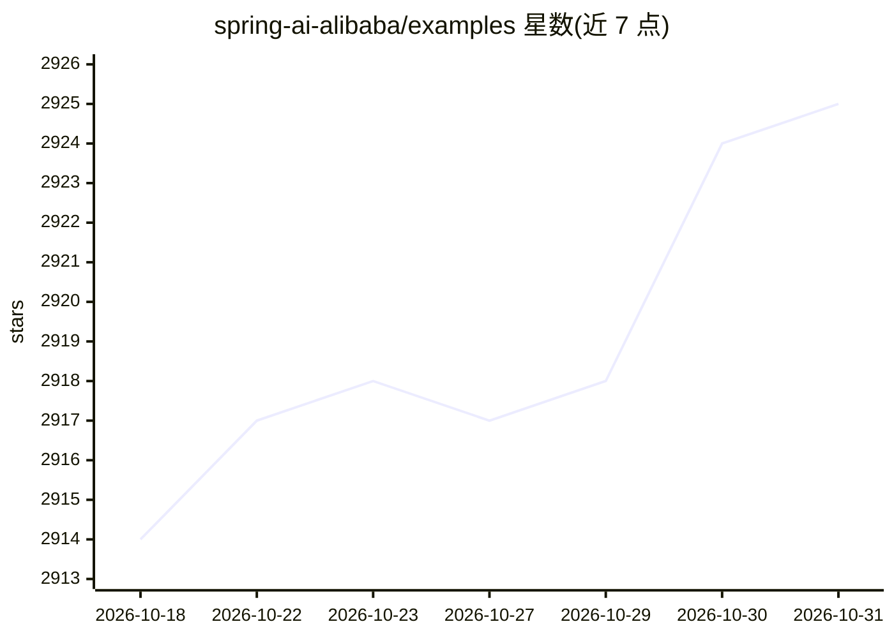

# spring-ai-alibaba/examples

⭐ 2,925 · Java · Apache-2.0 · 推送 2026-07-01 · [GitHub](https://github.com/spring-ai-alibaba/examples) · [官网](https://java2ai.com) · 组织维护 · 中文 README

**Spring AI Alibaba 官方示例集：演示框架各类用法**

包含多个 Example 模块项目，介绍 Spring AI 与 Spring AI Alibaba 从基础到高级的用法与 AI 项目实践：基础聊天、Advisor、图像生成、MCP、RAG、工具调用、Mem0、评测及 graph 等。提供 Quickstart Matrix 列出各模块的 mvn 启动命令、所需服务与环境变量，并附常用配置键速查（DashScope/OpenAI/DeepSeek/MiniMax/智谱等 API Key）与启动问题排查。面向使用该框架的 Java 开发者，需自行配置模型 API Key，部分示例需先启动向量库等本地中间件。

## 筛选速览

| 维度 | 判定 | 备注 |
|---|---|---|
| AI 角色 | `ai-knowledge` | 知识聚合/清单类 |
| 许可风险 | `permissive` | Apache-2.0 |
| 部署形态 | `None` |  |
| 模型依赖 | local-ok | 支持本地模型 |
| 硬件要求 | — | 无带数字的原话,不猜 |
| 安装摩擦 | `medium` | 含编译或系统依赖之一 |
| 成熟度 | — | 结构信号不足 |

## 能力要点

- Quickstart Matrix 列出各示例的 mvn 启动命令、所需服务与环境变量
- 覆盖 chat、图像生成、MCP、RAG、tool calling、graph 等示例类型
- 常用配置键速查覆盖 DashScope/OpenAI/DeepSeek/MiniMax/智谱等
- 附常见启动问题排查说明

## 适用场景

- 学习 Spring AI / Spring AI Alibaba 的接入方式
- 查找特定场景（RAG、MCP、tool calling）的示例代码
- 排查示例启动时的环境变量与本地服务依赖问题

## 场景标签

`教程课程` · 领域:学习与行业

## 证据(README 行号)

> L13: 此仓库中包含许多 Example 模块项目来介绍 Spring AI 和 Spring AI Alibaba 从基础到高级的各种用法和 AI 项目的最佳实践。
> L25: |spring-ai-alibaba-helloworld|basic chat and advisor examples|`mvn -pl spring-ai-alibaba-helloworld spring-boot:run

## 星数曲线

2026-10-18 2,914 → 2026-10-31 2,925（+11）

---
*卡片 v1 · prompt 1.4 · 生成 2026-10-21 · 置信度 high · 依据 README sha `72c1a2d64d21` · [字段定义](../../DATASET.md)*
