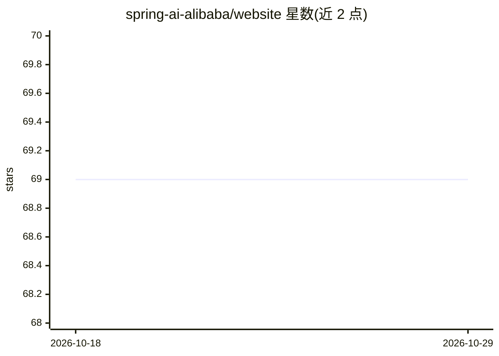

# spring-ai-alibaba/website

⭐ 69 · CSS · Apache-2.0 · 推送 2026-07-12 · [GitHub](https://github.com/spring-ai-alibaba/website) · [官网](https://java2ai.com) · 组织维护 · 中文 README

**Spring AI Alibaba 官方文档站源码（Docusaurus）**

Spring AI Alibaba 项目官方文档网站的源码仓库，基于 Docusaurus 构建，提供中文（默认）与英文两种预览与构建方式，通过 make 命令完成安装、预览、构建与服务。仓库还包含提交前的 npm-lint 与 markdown 格式检查流程、Pangu 空格格式化工具及中文文档写作指南链接。面向的是为该项目贡献或改进文档的开发者，而非框架的最终使用文档消费者。

## 筛选速览

| 维度 | 判定 | 备注 |
|---|---|---|
| AI 角色 | `ai-knowledge` | 知识聚合/清单类 |
| 许可风险 | `permissive` | Apache-2.0 |
| 部署形态 | `library` | 以包/库形式分发 |
| 模型依赖 | — | README 未给出锁定关系 |
| 硬件要求 | — | 无带数字的原话,不猜 |
| 安装摩擦 | `medium` | 含编译或系统依赖之一 |
| 成熟度 | — | 结构信号不足 |

## 能力要点

- 基于 Docusaurus 的文档站点源码
- make 命令一键安装、预览、构建（中/英文切换）
- 提供 CI 格式检查（npm-lint、markdown）与 Pangu 空格格式化

## 适用场景

- 为 Spring AI Alibaba 项目贡献或修改文档
- 本地预览和构建中英文文档站
- 了解该项目文档的写作与格式规范

## 场景标签

 · 领域:AI 框架文档/网站

## 证据(README 行号)

> L1: # Spring AI Alibaba Documentation Website
> L3: The official documentation website for the Spring AI Alibaba project, built with Docusaurus.

## 星数曲线

2026-10-18 69 → 2026-10-29 69（+0）

---
*卡片 v1 · prompt 1.4 · 生成 2026-10-24 · 置信度 mid · 依据 README sha `87f490b27950` · [字段定义](../../DATASET.md)*
