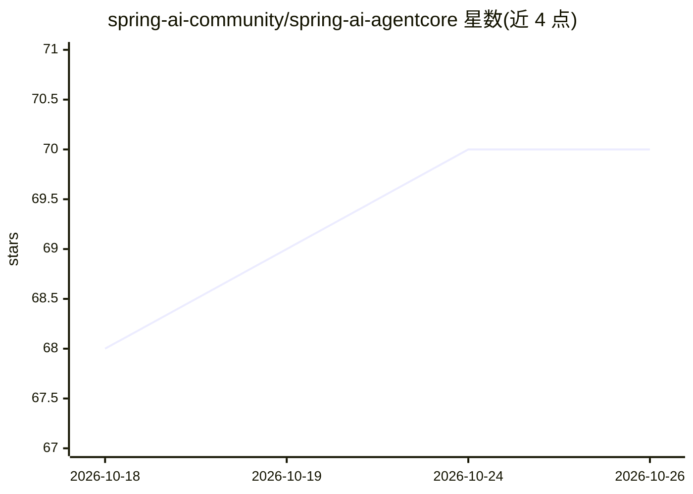

# spring-ai-community/spring-ai-agentcore

⭐ 70 · Java · Apache-2.0 · 推送 2026-10-25 · [GitHub](https://github.com/spring-ai-community/spring-ai-agentcore) · 组织维护

**将 Amazon Bedrock AgentCore 能力接入 Spring AI 的集成库**

面向 Spring Boot 开发者的开源集成库：通过注解、自动配置与可组合 advisors，把 Amazon Bedrock AgentCore 的能力带入 Spring AI。模块覆盖 Runtime 端点（/invocations、/ping、SSE 流式、限流）、身份凭证、x402 支付、短期/长期记忆、基于 Playwright 的浏览器操作、代码解释器与 Artifact 存储。支持部署到 AgentCore Runtime（ARM64 容器、ECR）或在 EKS/ECS/EC2/本地独立使用。要求 Java 17+、Spring Boot 4.x 与 AWS 账户，以 Maven 依赖方式引入。

## 筛选速览

| 维度 | 判定 | 备注 |
|---|---|---|
| AI 角色 | `ai-ecosystem` | LLM/agent 周边工具 |
| 许可风险 | `permissive` | Apache-2.0 |
| 部署形态 | `None` |  |
| 模型依赖 | locked-api |  |
| 硬件要求 | — | 无带数字的原话,不猜 |
| 安装摩擦 | `medium` | 含编译或系统依赖之一 |
| 成熟度 | — | 结构信号不足 |

## 能力要点

- Runtime Starter 自动配置 /invocations、/ping 端点与 SSE 流式、限流
- 短期/长期记忆模块（语义、偏好、摘要、情景记忆）
- 基于 Playwright 的浏览器模块与安全代码解释器
- x402 付费 API 支付工具封装与支付会话预算

## 适用场景

- 在 Spring Boot 应用中构建带记忆与浏览器能力的 agent
- 将 Spring AI agent 部署到 AgentCore Runtime 或自有基础设施
- 为付费 API 接入 x402 支付包装工具

## 场景标签

`Agent 框架` `Agent 记忆` `浏览器自动化` · 领域:Agent 开发

## 证据(README 行号)

> L7: An open-source library that brings Amazon Bedrock AgentCore capabilities into Spring AI through familiar patterns: a
> L54: - **AgentCore Runtime** — Fully managed: package as ARM64 container, push to ECR, create a runtime. Scales to zero,
> L76: - Java 17+

## 星数曲线

2026-10-18 68 → 2026-10-26 70（+2）

---
*卡片 v1 · prompt 1.4 · 生成 2026-10-24 · 置信度 high · 依据 README sha `58b9bc5d3a17` · [字段定义](../../DATASET.md)*
