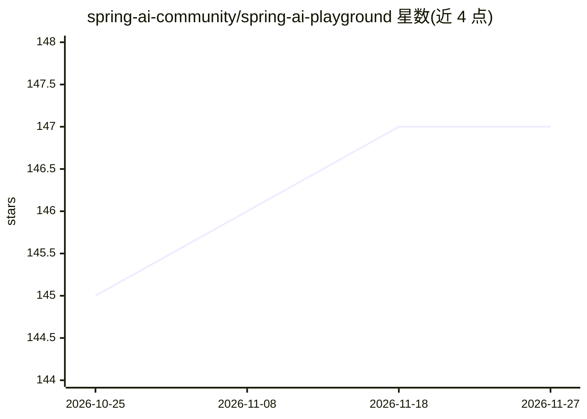

# spring-ai-community/spring-ai-playground

⭐ 147 · Java · Apache-2.0 · 推送 2026-11-03 · [GitHub](https://github.com/spring-ai-community/spring-ai-playground) · [官网](https://spring-ai-community.github.io/spring-ai-playground/) · 组织维护

**本地安全构建与运行 MCP 工具的桌面应用**

跨平台桌面应用，聚焦 MCP 工具的本地构建、测试与受控执行：工具需先通过 Local Pass 测试运行才会暴露给内置 MCP server；提供 Tool Studio（JavaScript 编写工具）、沙箱执行与 L0-L5 风险分级、敏感调用的人工确认、内置可观测性面板（日志/追踪/成本）与 RAG 流水线编排。无需 Java/Spring 知识，通过 GitHub Releases 安装包分发，覆盖 macOS、Windows、Linux。

## 筛选速览

| 维度 | 判定 | 备注 |
|---|---|---|
| AI 角色 | `ai-ecosystem` | LLM/agent 周边工具 |
| 许可风险 | `permissive` | Apache-2.0 |
| 部署形态 | `desktop` | 安装包/桌面程序 |
| 模型依赖 | local-ok | 支持本地模型 |
| 硬件要求 | — | 无带数字的原话,不猜 |
| 安装摩擦 | `low` | 无编译、无系统依赖或容器化 |
| 成熟度 | — | 结构信号不足 |

## 能力要点

- No pass, no run：工具须本地测试通过才可被 agent 调用
- deny-first 允许列表沙箱、SSRF 防护与按工具 L0-L5 风险分级
- 内置 MCP server 与外部 MCP 服务器代理聚合（Gmail/Notion/Slack 等）
- Shipyard 将已验证工具导出为独立 MCP server 并在 Docker 上运行

## 适用场景

- 为 Claude Desktop、Cursor 等 MCP 客户端构建并验证可复用工具
- 让 AI 编写/发布工具时逐步人工审批风险操作
- 把文档建成可检视的 RAG 知识并发布为搜索工具

## 场景标签

`LLM 可观测性` `RAG` · 领域:评测与运维

## 证据(README 行号)

> L3: **Safe Local Execution Layer for AI Agent Tools**
> L5: Spring AI Playground is a cross-platform desktop app for building, testing, validating, and executing MCP tools in a
> L97: - **Built-In MCP Server**: Publish tools directly from the app and expose them immediately through the built-in MCP

## 星数曲线

2026-10-25 145 → 2026-11-27 147（+2）

---
*卡片 v1 · prompt 1.4 · 生成 2026-11-27 · 置信度 mid · 依据 README sha `dd9b5f01535f` · [字段定义](../../DATASET.md)*
