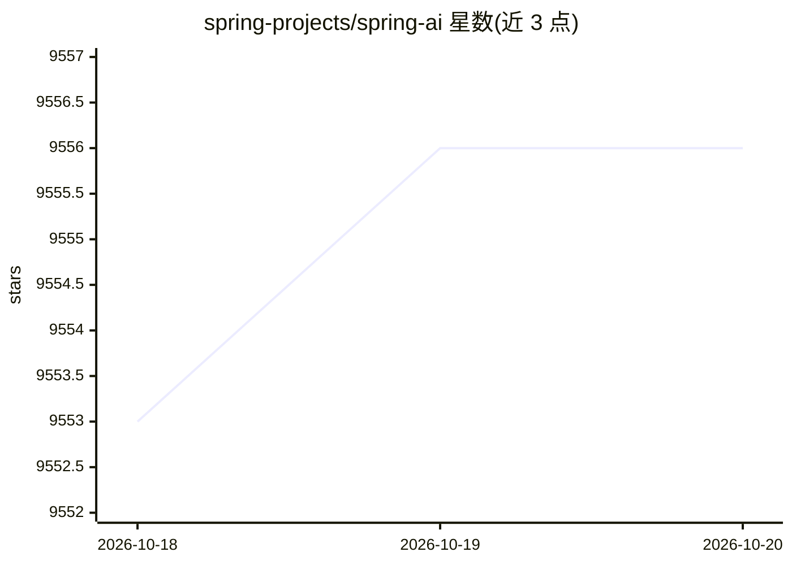

# spring-projects/spring-ai

⭐ 9,556 · Java · Apache-2.0 · 推送 2026-10-16 · [GitHub](https://github.com/spring-projects/spring-ai) · [官网](https://spring.io/projects/spring-ai ) · 组织维护

**面向 Java/Spring 开发者的 AI 应用开发框架**

Spring 生态的 AI 应用框架：提供可移植的 API 与抽象，将企业数据、API 与 AI 模型连接。支持主流模型提供商（OpenAI、Anthropic、Amazon Bedrock、Ollama、DeepSeek 等）的 Chat/Embedding/转录等模型类型，支持约 25 种向量存储的统一 API 与 SQL 式元数据过滤，另含工具调用、结构化输出、RAG、对话记忆、模型评测、可观测性与 MCP 一等支持。以 Maven 依赖与 Spring Boot Starters 形式提供，2.x 对应 Spring Boot 4.x，1.1.x 对应 3.5.x。

## 筛选速览

| 维度 | 判定 | 备注 |
|---|---|---|
| AI 角色 | `ai-ecosystem` | LLM/agent 周边工具 |
| 许可风险 | `permissive` | Apache-2.0 |
| 部署形态 | `None` |  |
| 模型依赖 | local-ok | 支持本地模型 |
| 硬件要求 | — | 无带数字的原话,不猜 |
| 安装摩擦 | `low` | 无编译、无系统依赖或容器化 |
| 成熟度 | — | 结构信号不足 |

## 能力要点

- 跨 AI 提供商的可移植 API（同步与流式）
- 约 25 种向量存储统一 API 与 SQL 式元数据过滤
- Tool Calling、结构化输出（POJO 映射）、RAG 与对话记忆
- MCP 一等支持（Boot Starters、Java 注解、STDIO/SSE/Streamable-HTTP）

## 适用场景

- 在 Spring Boot 应用中接入多种大模型与向量存储
- 构建带 RAG 与对话记忆的企业问答系统
- 通过 MCP 消费 MCP 服务器或将 Spring 服务暴露给 AI 生态

## 场景标签

`RAG` `Agent 框架` · 领域:Agent 开发

## 证据(README 行号)

> L3: The Spring AI project provides a Spring-friendly API and abstractions for developing AI applications.
> L5: Its goal is to apply Spring ecosystem design principles, such as portability and modular design, to the AI domain an
> L9: At its core, Spring AI addresses the fundamental challenge of AI integration: connecting your enterprise __Data__ an

## 星数曲线

2026-10-18 9,553 → 2026-10-20 9,556（+3）

---
*卡片 v1 · prompt 1.4 · 生成 2026-10-20 · 置信度 high · 依据 README sha `b0bc5d8488be` · [字段定义](../../DATASET.md)*
