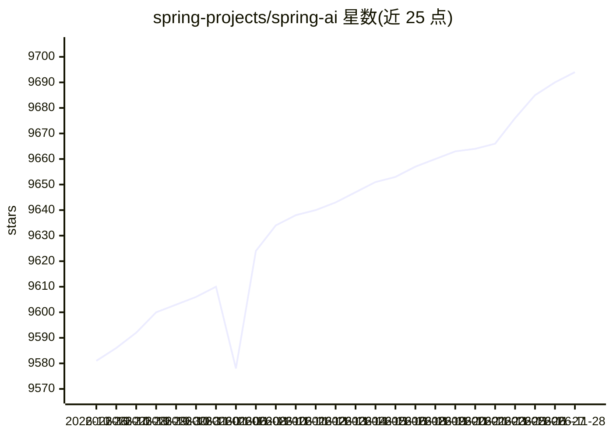

# spring-projects/spring-ai

⭐ 9,694 · Java · Apache-2.0 · 推送 2026-11-27 · [GitHub](https://github.com/spring-projects/spring-ai) · [官网](https://spring.io/projects/spring-ai ) · 组织维护

**Java/Spring 开发者构建 AI 应用的框架**

Spring 官方的 AI 应用开发框架，将 Spring 生态的设计原则（可移植、模块化、强类型 API）应用到 AI 领域。核心构件包括 ChatClient 流式/同步调用 API、Adversors 封装常见生成式 AI 模式、结构化输出映射、工具调用、会话记忆、Agent 工作流，以及跨供应商的模型 API 与向量库抽象，内置 MCP 支持、可观测性、评估与容错。通过 Spring Boot Starters 接入，项目从 start.spring.io 创建，需搭配 Spring Boot 对应版本（README 给出 2.1.x 对 Boot 4.2.x 等兼容表）。

## 筛选速览

| 维度 | 判定 | 备注 |
|---|---|---|
| AI 角色 | `ai-ecosystem` | LLM/agent 周边工具 |
| 许可风险 | `permissive` | Apache-2.0 |
| 部署形态 | `self-host` | docker 或自建部署 |
| 模型依赖 | local-ok | 支持本地模型 |
| 硬件要求 | — | 无带数字的原话,不猜 |
| 安装摩擦 | `low` | 无编译、无系统依赖或容器化 |
| 成熟度 | — | 结构信号不足 |

## 能力要点

- 跨供应商的可移植模型 API：Chat/Embedding/Image/语音转录/Moderation
- 支持主流向量库的可移植 Vector Store API 与 SQL 风格元数据过滤
- MCP 一等支持：Boot Starters 与 MCP Java Annotations
- 可观测性、评估测试（Testcontainers/Docker Compose）与重试守卫

## 适用场景

- 在 Spring Boot 企业应用中接入多家大模型服务
- 用统一 API 构建 RAG 流程与向量检索
- 为 Spring 服务构建 MCP server 暴露给 AI 生态
- 需要结构化输出与会话记忆的对话应用

## 场景标签

`RAG` `Agent 框架` · 领域:Agent 开发

## 证据(README 行号)

> L3: The Spring AI project provides a Spring-friendly API and abstractions for developing AI applications.
> L5: Its goal is to apply Spring ecosystem design principles, such as portability and modular design, to the AI domain an
> L9: The building blocks of Spring AI: the ChatClient and its features, the model APIs and providers, vector stores and r

## 星数曲线

2026-10-26 9,581 → 2026-11-28 9,694（+113）

---
*卡片 v1 · prompt 1.4 · 生成 2026-11-22 · 置信度 mid · 依据 README sha `4ed6b87d5392` · [字段定义](../../DATASET.md)*
