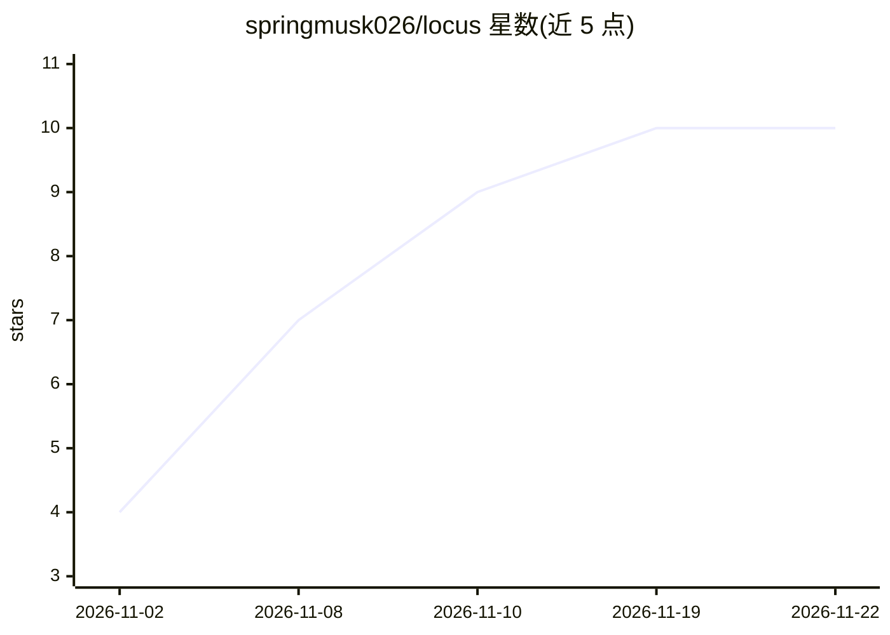

# springmusk026/locus

⭐ 10 · Kotlin · AGPL-3.0 · 推送 2026-11-21 · [GitHub](https://github.com/springmusk026/locus) · 个人维护

**本地优先的 Android AI Agent，自带模型与工具执行环境**

运行在 Android 手机上的 AI Agent 应用：接入用户自选的模型（API key、ChatGPT 订阅、OpenAI 兼容服务器或端上模型），为模型提供 Linux shell、可控浏览器、SSH、文件与日历等工具，支持子 Agent 并行、任务审批、污点追踪与密钥加密存储。应用本身无账号无服务器，无遥测。安装方式为从 GitHub Releases 获取 APK，需 64 位 Android 8.0+。项目处于活跃开发状态，部分功能标注为 (next) 未进入发布版。

## 筛选速览

| 维度 | 判定 | 备注 |
|---|---|---|
| AI 角色 | `ai-native` | 本体是模型或模型工具 |
| 许可风险 | `viral` | AGPL-3.0 |
| 部署形态 | `None` |  |
| 模型依赖 | local-ok | 支持本地模型 |
| 硬件要求 | — | 无带数字的原话,不猜 |
| 安装摩擦 | `medium` | 含编译或系统依赖之一 |
| 成熟度 | `idea` | |

## 能力要点

- 模型可自选：Anthropic/OpenAI key、ChatGPT 订阅登录、OpenAI 兼容服务器、端上 Gemma 与 GGUF
- Alpine Linux shell 与可观察的 Agent 浏览器作为执行环境
- 每个工具 Allow/Ask/Deny 审批、污点追踪与 Tink 加密的密钥存储
- MCP 服务器接入、最多三个并行子 Agent、任务回执与分支/记忆管理

## 适用场景

- 在手机上让 Agent 代为执行多步研究与代码任务
- 通过 MCP 和连接器让 Agent 操作 GitHub、邮件等自有服务
- 端上运行模型，实现无外网的本地 Agent 使用

## 场景标签

`AI 助手` · 领域:对话与助手

## 证据(README 行号)

> L4: **An AI agent that lives on your Android phone and works with the model you choose.**
> L20: Locus gives a capable model hands on your phone: a Linux shell, a browser you can watch, your files, your calendar 
> L38: - Anthropic and OpenAI API keys, your **ChatGPT Plus or Pro plan** through OpenAI's official sign-in, any OpenAI-co

## 星数曲线

2026-11-02 4 → 2026-11-22 10（+6）

---
*卡片 v1 · prompt 1.4 · 生成 2026-11-19 · 置信度 high · 依据 README sha `aa0a4a6710e5` · [字段定义](../../DATASET.md)*
