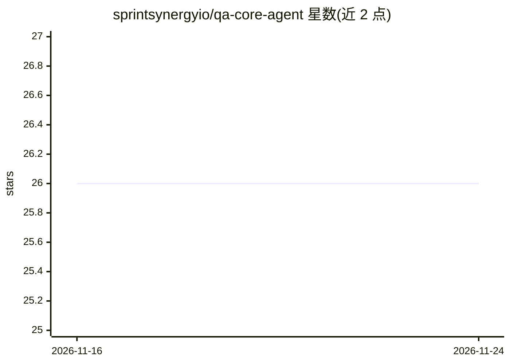

# sprintsynergyio/qa-core-agent

⭐ 26 · TypeScript · MIT · 推送 2026-11-20 · [GitHub](https://github.com/sprintsynergyio/qa-core-agent) · [官网](https://sprintsynergy.com) · 组织维护

**用 Claude 驱动真实浏览器探索并生成已验证通过的 Playwright 测试**

QA-Core 是基于 Claude 的 Playwright 测试生成 AI agent，通过 OpenClaw 分发。提供三个命令：explore 输入 URL 生成带 Page Object Model 的完整测试套件；generate 依据用户故事或 Jira ticket 生成规格；heal 修复因页面变更而失效的选择器。内部为五阶段流水线（Planner/Explorer/Critic/Reality-Check Replay/Stability Iteration），每个场景须在全新浏览器上下文中通过五次独立执行才写入文件，并输出 flake_rate 指标。需要 ANTHROPIC_API_KEY，多页发现遵循 robots.txt，运行受成本上限（默认 $2）约束，支持检查点崩溃恢复。

## 筛选速览

| 维度 | 判定 | 备注 |
|---|---|---|
| AI 角色 | `ai-native` | 本体是模型或模型工具 |
| 许可风险 | `permissive` | MIT |
| 部署形态 | `library` | 以包/库形式分发 |
| 模型依赖 | locked-api |  |
| 硬件要求 | — | 无带数字的原话,不猜 |
| 安装摩擦 | `low` | 无编译、无系统依赖或容器化 |
| 成熟度 | — | 结构信号不足 |

## 能力要点

- 五阶段 agent 流水线，场景须经五次独立执行通过才落盘
- selector 级联（getByRole→getByLabel→getByTestId→CSS）与歧义透明记录
- 自动注入 @axe-core/playwright 的 WCAG 2 AA 可访问性检查
- per-host 记忆缓存使同站点重复运行成本降低
- 数据驱动测试自动参数化与 storageState 会话复用

## 适用场景

- 为新上线的 Web 应用自动生成可直接运行的 E2E 测试套件
- 从用户故事或 Jira ticket 生成验收标准对应的测试
- 页面改版后自动修复失效选择器
- 盘点整站页面并按功能覆盖生成测试

## 场景标签

`浏览器自动化` · 领域:效率与自动化

## 证据(README 行号)

> L5: QA-Core is an AI agent that opens a real browser, explores your app, reviews its own work, and writes a Playwright t
> L29: * The **Planner** uses Haiku to read one page snapshot and write a numbered scenario list.

## 星数曲线

2026-11-16 26 → 2026-11-24 26（+0）

---
*卡片 v1 · prompt 1.4 · 生成 2026-11-18 · 置信度 mid · 依据 README sha `47fec905f0d6` · [字段定义](../../DATASET.md)*
